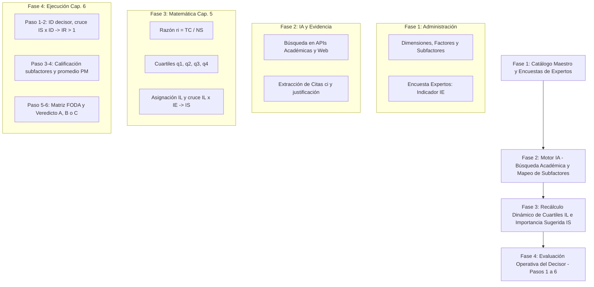

# Fases Metodológicas e Integración de Inteligencia Artificial (GUIOS)

Este documento describe la evolución metodológica de la guía **GUIOS** (basada en la tesis doctoral de *Víctor Hugo Rea Sánchez*) al incorporar **Inteligencia Artificial para la búsqueda y extracción dinámica de literatura científica y cálculo adaptativo de cuartiles por software evaluado**.

---

## 1. Justificación y Fundamento Teórico

### El problema de la Tabla 5.3 Estática en la Tesis Original
En el prototipo original **GUIOS PRO**, los indicadores de **Importancia de la Literatura ($IL$)** y la **Importancia Sugerida ($IS$)** se calcularon de forma estática a partir de una revisión sistemática manual de 54 artículos seleccionados entre 4,429 artículos iniciales (Capítulo 4 y 5 de la tesis).

Esto implicaba que cualquier software evaluado (ya sea *LibreOffice* de ofimática, *PostgreSQL* de base de datos, *Odoo* como ERP o *Ubuntu* como sistema operativo) utilizaba **exactamente las mismas citas**, la misma razón $r_i$ y los mismos cortes de cuartiles.

### La Solución Dinámica con IA
En un entorno real, la literatura científica sobre la adopción varía drásticamente según el dominio y la madurez de la solución tecnológica:
* En **Seguridad Informática**, la literatura cita recurrentemente "control de acceso" e "historial de vulnerabilidades" (elevando el $IL$ de **Fiabilidad** a 4).
* En **Diseño Gráfico / Ofimática**, las investigaciones priorizan "interfaz gráfica amigable (GUI)" y "compatibilidad con formatos propietarios" (elevando el $IL$ de **Usabilidad** y **Compatibilidad**).

Al variar el número de citas encontradas para el software $c_i$, varía la razón $r_i = \frac{c_i}{n}$, cambian dinámicamente los 4 cortes de los cuartiles ($q_1, q_2, q_3, q_4$), se recalcula el $IL$ y se obtiene una **Importancia Sugerida ($IS$) personalizada para cada software**.

---

## 2. Las 4 Fases Metodológicas del Sistema

---

### Fase 1: Catálogo Maestro y Encuestas de Expertos (Administración)
1. **Mantenimiento del Catálogo**:
   * CRUD de **Dimensiones** (Tecnológica, Organizacional, Económica, o nuevas).
   * CRUD de **Factores** (18 factores base de la tesis con su ámbito predeterminado `internal`, `external`, `both`).
   * CRUD de **Subfactores** (las 61 afirmaciones verificables redactadas en positivo con palabras clave de IA).
2. **Importancia del Experto ($IE$)**:
   * Indicador cuantitativo en escala $[1, 4]$ derivado de las encuestas Likert a especialistas TIC (Apéndice A de la tesis).
   * Soporta segmentación por categoría de software (Educación, Ofimática, ERP, Nube, etc.).

---

### Fase 2: Motor de IA - Búsqueda Académica con OpenAlex y Mapeo Semántico
*(Ver especificación técnica completa y validación en [INTEGRACION_OPENALEX_LITERATURA.md](file:///c:/Proyectos/Guios/docs/INTEGRACION_OPENALEX_LITERATURA.md))*.

Al crear una nueva evaluación ingresando `software_name`, `software_category`, `software_repo_url`, `org_sector` y `org_description`:
1. **Recuperación Bibliográfica Primaria con OpenAlex (`openalex.py`)**:
   * **Limpieza de Nombre Raíz**: `extract_root_software_name` remueve sufijos de distribución como *"Community"*, *"Enterprise"*, *"Server"*, *"CE"*, etc.
   * **Estrategia en 4 Etapas**: Consulta progresiva (Exacta con contexto $\rightarrow$ Raíz con contexto $\rightarrow$ Raíz entrecomillada $\rightarrow$ Búsqueda amplia).
   * **Filtro de Relevancia Temática**: Valida que el software se mencione explícitamente en el título o en el abstract reconstruido (`abstract_inverted_index`).
   * **Polite Pool y DOI**: Peticiones autenticadas por correo institucional y filtro estricto `filter=has_doi:true` recuperando hasta 20 publicaciones indexadas.
2. **Mapeo Semántico Multi-Criterio con LLM (`literature_evidence.py`)**:
   * Se alimenta al LLM (Azure OpenAI `gpt-5-mini`, Groq `Llama 3.3` o Cohere) con los 61 subfactores del catálogo y la colección de artículos de OpenAlex con sus resúmenes y DOIs.
   * El LLM realiza un mapeo exhaustivo: un artículo con arquitectura integral puede respaldar múltiples subfactores simultáneos (seguridad, integración, arquitectura, usabilidad).
   * Se extrae para cada subfactor: el `doi`, `url`, título y un fragmento textual justificativo (*snippet*).
   * Se asigna `evidence_origin = "openalex"`. Si OpenAlex no arrojase resultados, se activa la degradación elegante a documentación técnica oficial (`evidence_origin = "model"`) o contingencia heurística doctoral (`evidence_origin = "catalog_baseline"`).

---

### Fase 3: Recálculo Dinámico de Cuartiles ($IL$) e Importancia Sugerida ($IS$)
Ejecución del motor matemático determinista (Capítulo 5):

1. **Razón $r_i$ por Factor** (Ecuación 5.1):
   $$r_i = \frac{TC_i}{NS_i}$$
   Donde $TC_i$ es el total de citas encontradas por la IA en los subfactores del factor $i$, y $NS_i$ es el número de subfactores activos de dicho factor ($NS_i \ge 1$).

2. **Cálculo de Cuartiles de la Evaluación** ($q_1, q_2, q_3, q_4$):
   * Se ordenan ascendentemente los valores $r_i$ de los factores participantes.
   * Se determinan los percentiles al 25% ($q_1$), 50% ($q_2$), 75% ($q_3$) y 100% ($q_4$) mediante interpolación lineal.
   * Caso de borde: Si múltiples factores no tienen citas ($r_i = 0$), el corte $q_1 = 0$ asigna $IL = 1$ sin división por cero ni discontinuidades.

3. **Asignación de Importancia de la Literatura ($IL$)** (Ecuación 5.2):
   $$IL_i = \begin{cases}
   1 \text{ (Irrelevante)} & \text{si } r_i \le q_1 \\
   2 \text{ (Opcional)}    & \text{si } q_1 < r_i \le q_2 \\
   3 \text{ (Importante)}  & \text{si } q_2 < r_i \le q_3 \\
   4 \text{ (Fundamental)} & \text{si } q_3 < r_i \le q_4
   \end{cases}$$

4. **Matriz de Combinación para Importancia Sugerida ($IS$)** (Figura 5.10):
   Cruce entre $IL$ (Literatura calculada por IA) e $IE$ (Experto):

| $IE$ (Experto) \ $IL$ (Literatura) | 1 (Irrelevante) | 2 (Opcional) | 3 (Importante) | 4 (Fundamental) |
| :--- | :---: | :---: | :---: | :---: |
| **4 (Fundamental)** | 2 (Opcional) | 3 (Importante) | 3 (Importante) | 4 (Fundamental) |
| **3 (Importante)** | 2 (Opcional) | 2 (Opcional) | 3 (Importante) | 3 (Importante) |
| **2 (Opcional)** | 1 (Irrelevante) | 2 (Opcional) | 2 (Opcional) | 3 (Importante) |
| **1 (Irrelevante)** | 1 (Irrelevante) | 1 (Irrelevante) | 2 (Opcional) | 2 (Opcional) |

---

### Fase 4: Evaluación Operativa del Decisor (Capítulo 6)

1. **Pasos 1 y 2 - Relevancia y Ámbito**:
   * El decisor visualiza la tabla dinámica de factores con el $IS$ sugerido por la IA y puede inspeccionar la evidencia científica encontrada.
   * Asigna su **Importancia del Decisor ($ID$)** en rango $[1, 4]$.
   * El sistema cruza $(IS, ID)$ con la misma matriz de la Figura 5.10 para obtener la **Importancia Relativa ($IR$)**.
   * **Filtro de Relevancia**: Si $IR > 1$, el factor es **Relevante** y avanza al Paso 3; si $IR = 1$, se descarta de la evaluación.

2. **Pasos 3 y 4 - Calificación y Ponderación Media ($PM$)**:
   * Para cada subfactor de los factores relevantes, el evaluador califica el cumplimiento de 1 a 4 ($1$: No cumple, $2$: Desconozco, $3$: Cumple parcialmente, $4$: Cumple).
   * Se calcula la **Ponderación Media ($PM$)** por factor:
     $$PM = \frac{\sum_{j=1}^{n} \text{rating}_j}{n}$$
   * Se evalúa el umbral metodológico: **Cumple umbral** si $PM \ge 3.0$.

3. **Pasos 5 y 6 - Matriz FODA y Dictamen Final**:
   * Clasificación FODA según ámbito y $PM$ (Ecuación 5.3):
     * $PM \ge 3.0$ e Interno $\rightarrow$ **Fortaleza**
     * $PM \ge 3.0$ y Externo $\rightarrow$ **Oportunidad**
     * $PM < 3.0$ e Interno $\rightarrow$ **Debilidad**
     * $PM < 3.0$ y Externo $\rightarrow$ **Amenaza**
   * **Veredicto Final**:
     * **Recomendación C (Adoptar plenamente)**: Todos los factores relevantes cumplen el umbral ($PM \ge 3.0$).
     * **Recomendación B (Adoptar con Reservas / Plan de Mitigación)**: Existen debilidades o amenazas ($PM < 3.0$), pero **únicamente** en factores opcionales ($IR = 2$).
     * **Recomendación A (No viable sin mitigar riesgos)**: Existe al menos una debilidad o amenaza ($PM < 3.0$) en un factor crítico con $IR \ge 3$ (Importante o Fundamental).
