# Documento de Especificación Técnica: Integración de OpenAlex para Búsqueda de Literatura Científica y Mapeo con IA (GUIOS)

> **Estado:** Implementado y Validado en Producción / Master  
> **Fecha:** Octubre 2026  
> **Proyecto:** GUIOS PRO — Sistema de Evaluación de Adopción de Software Libre  
> **Base Metodológica:** Capítulos 4 y 5 de la Tesis Doctoral (*Víctor Hugo Rea Sánchez*)  
> **Módulos:** Backend `apps.guios` (Pipeline Asíncrono de IA y Literatura) y Frontend React/TypeScript

---

## 1. Justificación y Fundamentación Metodológica

### 1.1 Diagnóstico del Problema Previo
En iteraciones anteriores del sistema, la tarea asíncrona de Celery (`execute_evaluation_literature_ai_task`) delegaba la búsqueda de fuentes enteramente en el LLM (`Azure OpenAI gpt-5-mini`, `Groq Llama 3.3` o `Cohere Command-R`):
* **Comportamiento observado:** Los modelos generaban enlaces y títulos extraídos de su memoria paramétrica interna (`evidence_origin: "model"`), devolviendo URLs generales de repositorios o sitios de documentación y dejando el campo `doi: ""` vacío.
* **Problema metodológico:** La metodología formal de GUIOS establece que la **Importancia de la Literatura ($IL$)** y los umbrales de cuartiles ($q_1 \dots q_4$) deben sustentarse en el volumen de menciones de criterios técnicos en **literatura científica indexada** (artículos en conferencias arbitradas y revistas académicas con revisión por pares). Confiar en enlaces sintéticos desvirtúa el rigor empírico y la reproducibilidad de la tesis doctoral.

### 1.2 La Solución con OpenAlex
Se integró **OpenAlex** (catálogo bibliométrico abierto con más de 250 millones de obras indexadas) como la **fuente de verdad bibliográfica primaria**, mientras que los LLMs asumen su función ideal: el **razonamiento semántico y clasificación multi-criterio**:

1. **OpenAlex** recupera publicaciones científicas reales sobre el software evaluado con sus **DOIs**, títulos, revistas/conferencias, años de publicación y resúmenes estructurados (*abstracts*).
2. **El LLM** analiza los *abstracts* recuperados y determina qué subfactores del catálogo de GUIOS son abordados y respaldados por cada artículo.
3. **El Motor Matemático de GUIOS** calcula de forma determinista la razón $r_i$, los cuartiles relativos y la Importancia Sugerida ($IS$).

---

## 2. Arquitectura del Pipeline Asíncrono

El flujo opera en segundo plano mediante Celery, asegurando tiempos de respuesta inmediatos en la interfaz de usuario:

```mermaid
flowchart TD
    subgraph CeleryWorker["Worker de Celery (Segundo Plano)"]
        A["Tarea Celery: execute_evaluation_literature_ai_task(eval_id)"] --> B["Etapa 1: OpenAlexClient (Extracción Bibliométrica)"]
        
        subgraph Stage1["Etapa 1: OpenAlex API"]
            B --> B1["Limpieza y Extracción de Nombre Raíz<br>(extract_root_software_name)"]
            B1 --> B2["Búsqueda en 4 Etapas<br>(Exacta -> Raíz Contextual -> Raíz Exacta -> Amplia)"]
            B2 --> B3["Filtro de Relevancia Temática<br>(_is_relevant_work en Título o Abstract)"]
            B3 --> B4["Reconstrucción de Abstracts<br>(Inverted Index -> Texto Continuo)"]
            B4 --> B5["Colección de Papers Reales (Hasta 20)<br>[doi, title, venue, year, abstract]"]
        end
        
        B5 --> C["Etapa 2: Mapeo Semántico Multi-Criterio (LLM Azure/Groq)"]
        
        subgraph Stage2["Etapa 2: Inferencia LLM"]
            C --> C1["Prompt Multi-Criterio con Restricción de DOI<br>(61 Subfactores + Papers de OpenAlex)"]
            C1 --> C2["Mapeo Semántico Exhaustivo:<br>Paper (DOI) -> Varios Subfactores respaldados"]
            C2 --> C3["Extracción de Evidencias Textuales (Snippets)"]
        end
        
        C3 --> D["Etapa 3: Persistencia y Matemática Determinista"]
        
        subgraph Stage3["Etapa 3: Cálculo Metodológico GUIOS"]
            D --> D1["Almacenar sources_by_factor con DOIs verificados<br>evidence_origin = 'openalex'"]
            D1 --> D2["Calcular Razón de Citas r_i = TC / NS"]
            D2 --> D3["Calcular Cuartiles q1..q4 (Interpolación lineal)"]
            D3 --> D4["Asignar IL y cruzar con IE -> Importancia Sugerida IS"]
            D4 --> D5["Actualizar Evaluation: ai_status = 'completed'"]
        end
    end
    
    Trigger["Usuario crea Evaluación en Frontend"] -.->|"enqueue_literature_search"| A
```



---

## 3. Especificación Técnica de `OpenAlexClient`

Ubicación del código: [`backend/apps/guios/services/literature/openalex.py`](file:///c:/Proyectos/Guios/backend/apps/guios/services/literature/openalex.py)

### 3.1 Endpoint, Autenticación y Polite Pool
* **URL Base:** `https://api.openalex.org/works`
* **Método:** `GET`
* **Polite Pool (Cortesía Gratuita):** OpenAlex ofrece acceso prioritario sin costo con hasta 100.000 peticiones diarias y hasta 10 req/s al incluir un correo de contacto en el encabezado `User-Agent` o en el parámetro `mailto`.
  * Configuración: `OPENALEX_MAILTO` (configurable vía `.env`).
* **API Key Dedicada (Opcional):** Si se dispone de una clave premium de OpenAlex, se envía mediante el parámetro `api_key` o cabecera dedicada.
  * Configuración: `OPENALEX_API_KEY` (soporta inyección vía variable de entorno).
* **Timeout, Ventana Temporal y Capacidad:**
  * `OPENALEX_TIMEOUT_SECONDS = 15.0` segundos por petición.
  * `OPENALEX_MAX_RESULTS = 80` artículos únicos máximo por software evaluado (configurable vía settings).
  * `OPENALEX_YEAR_FROM = 2020` y `OPENALEX_YEAR_TO = 2025`: Restringe las publicaciones recuperadas exclusivamente al rango **2020–2025** tanto en el filtro de la API como en la validación local de resultados.
* **Filtros API:**
  * `filter=has_doi:true,is_paratext:false,is_retracted:false,publication_year:2020-2025`: Restringe los resultados a publicaciones académicas válidas con DOI formal, sin paratextos ni artículos retractados, dentro de la ventana temporal configurada.
  * `sort=relevance_score:desc`: Prioriza las obras más relevantes al término de consulta.

### 3.2 Extracción de Término Raíz (`extract_root_software_name`)
Los usuarios suelen introducir nombres comerciales o variantes como *"Odoo Community"*, *"Odoo Enterprise"*, *"Keycloak CE"*, *"Ubuntu Desktop"*, *"PostgreSQL Server"* o *"Nextcloud Hub"*. En la literatura científica, los investigadores suelen referirse simplemente a *"Odoo"*, *"Keycloak"* o *"PostgreSQL"*.

La función normaliza y elimina sufijos de distribución no indexados:
```python
def extract_root_software_name(name: str) -> str:
    """Extrae la marca o nombre raíz del software ignorando descriptores de edición."""
    clean = re.sub(r'[\(\)\[\]\{\}",\']', '', name).strip()
    words = clean.split()
    if len(words) <= 1:
        return clean

    descriptors = {
        "community", "enterprise", "server", "desktop", "suite",
        "edition", "core", "hub", "platform", "ce", "ee", "oss",
        "open", "source", "client", "app",
    }
    filtered = [w for w in words if w.lower() not in descriptors]
    return " ".join(filtered) if filtered else words[0]
```

### 3.3 Estrategia de Búsqueda Progresiva en 4 Etapas
Para garantizar que nunca se obtengan resultados vacíos cuando existe literatura disponible, el cliente ejecuta una estrategia en cascada de cuatro etapas:

1. **Etapa 1 (Nombre Completo Exacto + Contexto):**
   ```python
   query = f'"{clean_name}" AND ({category_term} OR "open source" OR "FLOSS" OR "adoption" OR "software")'
   ```
2. **Etapa 2 (Nombre Raíz Contextual):**
   Si la etapa 1 retorna menos de 3 resultados y el nombre raíz difiere del nombre completo:
   ```python
   query = f'"{root_name}" AND ({category_term} OR "open source" OR "FLOSS" OR "adoption" OR "software")'
   ```
3. **Etapa 3 (Nombre Raíz Exacto Entrecomillado):**
   Si se obtienen menos de 3 resultados:
   ```python
   query = f'"{root_name}"'
   ```
4. **Etapa 4 (Búsqueda Amplia sin Comillas):**
   Último recurso si aún no se alcanza el umbral mínimo de trabajos académicos.

### 3.4 Filtro Estricto de Relevancia Temática (`_is_relevant_work`)
Para evitar falsos positivos o artículos donde el término aparezca de manera circunstancial en referencias bibliográficas, cada artículo recuperado es evaluado:
```python
def _is_relevant_work(self, work: AcademicWork, software_name: str, root_name: str) -> bool:
    """Valida que el software evaluado se mencione explícitamente en el título o abstract."""
    text_to_check = f"{work.title} {work.abstract}".lower()
    targets = {software_name.lower(), root_name.lower()}
    for target in targets:
        if len(target) < 3:
            continue
        pattern = rf"\b{re.escape(target)}\b"
        if re.search(pattern, text_to_check):
            return True
    return False
```

### 3.5 Reconstrucción del Abstract (Inverted Index)
OpenAlex almacena los resúmenes en formato de índice invertido (`abstract_inverted_index`) para compresión de datos. El cliente decodifica esta estructura a texto lineal de alto rendimiento:
```python
def reconstruct_abstract(inverted_index: dict[str, list[int]] | None) -> str:
    """Convierte el abstract_inverted_index de OpenAlex a texto continuo."""
    if not inverted_index:
        return ""
    max_pos = max((pos for positions in inverted_index.values() for pos in positions), default=-1)
    if max_pos < 0:
        return ""
    words = [""] * (max_pos + 1)
    for word, positions in inverted_index.items():
        for pos in positions:
            words[pos] = word
    return " ".join(words).strip()
```

### 3.6 Estructura de Datos `AcademicWork`
```python
@dataclass(frozen=True)
class AcademicWork:
    openalex_id: str         # "https://openalex.org/W2963847291"
    doi: str                 # "10.1109/ICSE.2023.00012"
    doi_url: str             # "https://doi.org/10.1109/ICSE.2023.00012"
    title: str               # Título del artículo científico
    publication_year: int    # Año de publicación (ej. 2024)
    venue_name: str          # Revista científica o conferencia (ej. "IEEE Software")
    cited_by_count: int      # Número de citas globales en OpenAlex
    abstract: str            # Texto continuo reconstruido del resumen
```

---

## 4. Mapeo Semántico Multi-Criterio con LLM

Ubicación del código: [`backend/apps/guios/services/ai/literature_evidence.py`](file:///c:/Proyectos/Guios/backend/apps/guios/services/ai/literature_evidence.py)

### 4.1 Principio de Cobertura Multi-Criterio
Un artículo científico sobre adopción de software libre (por ejemplo, una evaluación empírica de *Odoo*, *PostgreSQL* o *Keycloak*) suele examinar múltiples dimensiones a la vez:
* **Dimensión Tecnológica:** Arquitectura modular, APIs de integración, interoperabilidad con estándares abiertos, requerimientos de hardware.
* **Dimensión de Seguridad y Fiabilidad:** Control de acceso, auditoría de eventos, gestión de roles y permisos, tolerancia a fallos.
* **Dimensión Organizacional y Usabilidad:** Curva de aprendizaje para usuarios finales, documentación disponible, comunidad de soporte, facilidad de configuración.

El prompt del LLM fue diseñado para **no limitarse a una sola asociación por artículo**. Si el resumen de una publicación proporciona evidencia para 3 o 4 subfactores diferentes, el modelo debe relacionar el mismo artículo con cada uno de ellos, registrando la justificación específica (*snippet*).

### 4.2 Restricción Estricta de Identificadores DOI y Consistencia por Software (Enfoque A)
El pipeline de mapeo bibliográfico garantiza reproducibilidad científica y consistencia entre evaluaciones de un mismo software:
* **Desacoplamiento del contexto organizacional:** El prompt de mapeo (`build_literature_prompts`) omite intencionalmente el sector y la descripción de la organización adoptante para el cálculo bibliográfico ($IL$), atribuyendo citas exclusivamente sobre las capacidades técnicas y publicaciones del software evaluado. El contexto organizacional se reserva para las sugerencias de $ID$, calificaciones contextuales, dictamen ejecutivo y plan de mitigación.
* **Temperatura determinista (`temperature=0.0`):** Los proveedores Groq y Cohere operan con temperatura `0.0` en la extracción de citas.
* **Reutilización de Snapshot OpenAlex Consistente:** En evaluaciones sucesivas del mismo software raíz (`extract_root_software_name`) con igual catálogo de subfactores activos y ventana temporal (`OPENALEX_YEAR_FROM`–`OPENALEX_YEAR_TO`), `AIService` reutiliza el snapshot verificado con DOIs de la evaluación previa completada (`evidence_origin = "openalex_consistent_snapshot"`), manteniendo idénticos conteos de citas, $r_i$ y cuartiles.
* **Restricción de DOIs:** Está estrictamente prohibido inventar DOIs que no figuren en la colección provista por OpenAlex; si un factor no encuentra respaldo directo en los resúmenes ni en el backfill estricto de palabras clave (`BACKFILL_MIN_HITS = 2`), su conteo permanece en cero de forma metodológicamente honesta.

### 4.3 Formato de Respuesta del Modelo
```json
{
  "citations_by_subfactor": {
    "3": 1,
    "13": 1,
    "19": 1,
    "40": 1,
    "51": 1
  },
  "sources_by_factor": {
    "1": [
      {
        "doi": "10.70038/jentik.v2i3.128",
        "url": "https://doi.org/10.70038/jentik.v2i3.128",
        "title": "Integrasi REST API dan ODOO 17 Pada Manajemen Data Alumni UIN",
        "snippet": "El estudio documenta la integración mediante REST API con Odoo 17, evidenciando capacidad de integración con otros sistemas y APIs.",
        "subfactor_id": 3
      }
    ],
    "2": [
      {
        "doi": "10.33890/innova.v3.n8.1.2018.809",
        "url": "https://doi.org/10.33890/innova.v3.n8.1.2018.809",
        "title": "MEDDPOP: Una aplicación para Pymes del sector salud basada en ODOO",
        "snippet": "El artículo describe la arquitectura y componentes sobre Odoo, demostrando que la plataforma admite extensión mediante módulos reutilizables.",
        "subfactor_id": 13
      }
    ]
  },
  "ratings_by_subfactor": { "3": 4, "13": 4, "19": 3 },
  "importance_by_factor": { "1": 3, "2": 4 },
  "summary": "Se identificaron 5 publicaciones científicas indexadas en OpenAlex sobre Odoo..."
}
```

---

## 5. Persistencia, Auditoría y Trazabilidad

### 5.1 Registro en `AIAssistanceLog`
Cada ejecución asíncrona registra en base de datos un registro inmutable con los siguientes atributos de auditoría:
* `provider`: Proveedor de IA ejecutado (`AzureAIProvider`, `GroqAIProvider`, `CohereAIProvider`).
* `cascade_level`: Nivel alcanzado en la cascada (`primario`, `secundario`, `contingencia_heuristica`).
* `provider_info`: Modelo específico utilizado (ej. `Azure OpenAI (gpt-5-mini)`).
* `evidence_origin`: 
  * `"openalex"`: Se recuperaron publicaciones científicas reales con DOIs indexados.
  * `"model"`: Degradiación elegante a documentación y fuentes web cuando no hubo papers en OpenAlex.
  * `"catalog_baseline"`: Contingencia heurística utilizando las 54 obras base de la tesis doctoral.
* `latency_ms`: Tiempo de respuesta en milisegundos.
* `prompt_tokens` y `completion_tokens`: Métricas de consumo de tokens.
* `payload_sent` y `payload_received`: Registro completo de la evidencia bibliográfica y citas asociadas.

### 5.2 Estructura de Contingencia y Tolerancia a Fallos
```
[Nivel 1: OpenAlex Academic Works + Inferencia LLM]
  │  (Fallo de conexión a OpenAlex o 0 artículos indexados)
  ▼
[Nivel 2: Documentación Técnica Oficial con LLM]
  │  (Fallo en proveedores de LLM o cuotas excedidas)
  ▼
[Nivel 3: Catálogo Base Heurístico de la Tesis] (Datos de LibreOffice / 54 papers de Rea Sánchez)
```

---

## 6. Experiencia de Usuario y Componentes Frontend

### 6.1 Modal de Inspección de Fuentes Académicas (`FactorSourcesModal.tsx`)
Ubicación: [`frontend/src/features/guios/evaluations/components/detail/FactorSourcesModal.tsx`](file:///c:/Proyectos/Guios/frontend/src/features/guios/evaluations/components/detail/FactorSourcesModal.tsx)

Permite al decisor o auditor examinar las fuentes científicas que sustentan el cálculo de cada factor:
* **Badge DOI Activo:** Si el artículo proviene de OpenAlex, se muestra una insignia verde con el texto `DOI: 10.xxxx/...` que enlaza directamente a `https://doi.org/<DOI>` abriéndose en una pestaña nueva.
* **Insignia de Origen:** Etiqueta distintiva que indica *"Evidencia verificada con OpenAlex Academic Index"*.
* **Chips de Subfactores:** Muestra qué subfactores específicos fueron demostrados por el artículo.
* **Citas Académicas Formateadas:** Bloque de cita (*blockquote*) con el fragmento textual exacto del artículo que justifica la adopción.

### 6.2 Integración en Paso 1 del Asistente (`Step1FactorsConfig.tsx`)
Ubicación: [`frontend/src/features/publicEvaluation/components/steps/Step1FactorsConfig.tsx`](file:///c:/Proyectos/Guios/frontend/src/features/publicEvaluation/components/steps/Step1FactorsConfig.tsx)

* En la tabla de configuración de factores, junto a la columna de **Importancia Sugerida ($IS$)**, se añadió el botón interactivo **"Ver fuentes"**.
* El decisor puede consultar los DOIs y abstracts científicos antes de emitir su **Importancia del Decisor ($ID$)**, incrementando la confianza en el sistema.

### 6.3 Pestañas de Detalle de Evaluación (`EvaluationFactorsTab.tsx` y `EvaluationSubfactorsTab.tsx`)
* Muestran el conteo de DOIs verificados por factor y subfactor.
* Acceso directo al modal de fuentes desde el panel administrativo de evaluaciones.

### 6.4 Overlay de Carga Apple-Style (`AiThinkingOverlay.tsx`)
Ubicación: [`frontend/src/features/publicEvaluation/components/AiThinkingOverlay.tsx`](file:///c:/Proyectos/Guios/frontend/src/features/publicEvaluation/components/AiThinkingOverlay.tsx)

Diseñado siguiendo las directrices estéticas de interfaces de IA modernas (cápsula horizontal minimalista):
* **Cápsula oscura compacta:** Contenedor de `w-[450px]` y `h-[82px]` con fondo `bg-[#1c1c1e]`, esquinas redondeadas completas (`rounded-full`) y borde sutil de cristal.
* **Orbe Iridiscente Luminoso:** Esfera de vidrio con gradiente aurora animado en tonos magenta, cyan y dorado, simulando la refracción óptica de sistemas de IA generativa.
* **Tipografía "Thinking...":** Encabezado en escala de grises limpia (`#8e8e93`, 22px, `font-medium`).
* **Viewport de Subtítulo Fijo:** Contenedor de altura fija (`h-[24px]`) para los mensajes dinámicos de fase (*"Buscando literatura académica en OpenAlex..."*, *"Mapeando evidencias con criterios metodológicos..."*), garantizando **cero desplazamiento visual o saltos de layout** al cambiar el texto.

---

## 7. Batería de Pruebas y Validación

### 7.1 Pruebas Unitarias del Backend
Se desarrollaron pruebas dedicadas en [`backend/apps/guios/test/test_openalex_client.py`](file:///c:/Proyectos/Guios/backend/apps/guios/test/test_openalex_client.py):
* `test_search_works_success`: Simula la respuesta de OpenAlex y valida la normalización de DOIs, títulos y abstracts.
* `test_extract_root_software_name`: Verifica la eliminación correcta de sufijos como *"Community"*, *"Enterprise"*, *"Server"*, etc.
* `test_relevance_filtering`: Comprueba que se descarten artículos que no mencionen el software evaluado en el título ni en el abstract.
* `test_inverted_index_decoding`: Valida la reconstrucción precisa de párrafos completos a partir de diccionarios de posiciones.
* `test_timeout_and_fallback`: Asegura que excepciones de red o HTTP 5xx retornen una lista vacía de forma segura sin propagar errores al worker.

**Resultado de la suite de pruebas completa:**
```powershell
python manage.py test apps.guios.test
# Ran 139 tests in 7.391s
# OK
```

### 7.2 Validación del Frontend
Compilación de producción con TypeScript y Vite:
```powershell
npm run build
# vite v6.4.1 building for production...
# transforming...
# ✓ 310 modules transformed.
# rendering chunks...
# computing gzip size...
# dist/index.html                   0.82 kB │ gzip:  0.42 kB
# dist/assets/index-xxx.css        37.89 kB │ gzip:  7.51 kB
# dist/assets/index-xxx.js        526.41 kB │ gzip: 147.22 kB
# ✓ built in 1.85s (0 errors, 0 warnings)
```

### 7.3 Evidencia Real en Base de Datos (Caso Odoo Community)
Durante la prueba de integración con *Odoo Community*, el pipeline registró:
* **Término Raíz Extraído:** `"Odoo"`
* **Artículos Recuperados por OpenAlex:** 5 publicaciones indexadas con DOIs reales:
  * `10.70038/jentik.v2i3.128` — *Integrasi REST API dan ODOO 17 Pada Manajemen Data Alumni UIN*
  * `10.33890/innova.v3.n8.1.2018.809` — *MEDDPOP: Una aplicación para Pymes del sector salud basada en ODOO*
  * `10.70881/hnj/v4/n1/105` — *Control interno informático en los sistemas contables: Análisis del ERP Odoo community*
  * `10.61799/2216-0388.1725` — *Mejorando La Eficiencia En Procesos Empresariales Implementando Odoo*
* **Mapeo de Factores:** Factores 1, 2, 3, 9, 12 y 13 respaldados con evidencia textual y enlaces DOI verificables.
* **Origen de Evidencia:** `evidence_origin: "openalex"`.
