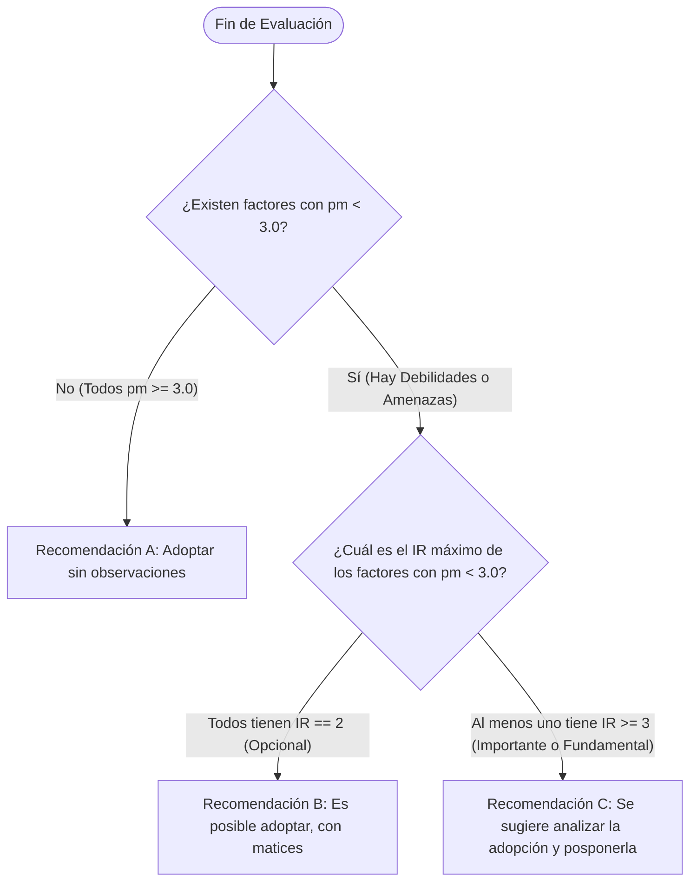

# README TÉCNICO: Especificación de Motores de Cálculo (GUIOS)

> **Documento de Especificación Metodológica y Algorítmica**  
> **Sistema**: GUIOS (Guía para la Adopción e Implementación de Software Libre / FLOSS)  
> **Referencia Académica**: Basado en los Capítulos 4, 5 y 6 de la Tesis Doctoral / Metodología GUIOS (Rea Sánchez).

Este documento detalla las fórmulas matemáticas, algoritmos de interpolación de cuartiles, matrices de cruce cartesiano y reglas de decisión que sustentan los servicios de backend para automatizar la evaluación y recomendación de adopción de software libre.

---

## Índice General

1. [Módulo 1: Literatura, Cuartiles e Importancia Sugerida ($IL$, $IE$ y $IS$)](#módulo-1-cálculos-de-literatura-cuartiles-e-importancia-sugerida-il-ie-y-is)
2. [Módulo 2: Cálculos de Relevancia del Decisor ($IR$)](#módulo-2-cálculos-de-relevancia-del-decisor-ir)
3. [Módulo 3: Cálculos de Ponderación y Análisis FODA](#módulo-3-cálculos-de-ponderación-y-análisis-foda)
4. [Módulo 4: Lógica de Decisión para el Veredicto Final](#módulo-4-lógica-de-decisión-para-el-veredicto-final)
5. [Matriz de Referencia Metodológica (Figura 5.10)](#matriz-oficial-figura-510)
6. [Resumen de Escalas y Rangos](#resumen-de-escalas-y-rangos)

---

## MÓDULO 1: Cálculos de Literatura, Cuartiles e Importancia Sugerida ($IL$, $IE$ y $IS$)
*(Basado en los Capítulos 4 y 5 de la metodología)*

Cuando se inicializa una evaluación (`Evaluation`) vinculada a un software candidato, el motor de IA recopila evidencias web y contabiliza las citas ($c_i$) asociadas a los subfactores de cada factor. A partir de ello, se ejecutan 4 pasos matemáticos secuenciales:

### 1. Razón de Citas por Factor ($r_i$)

Para cada factor activo $i$ (que posea al menos $NS_i \ge 1$ subfactores activos), se calcula la razón promedio de citas aplicando la **Ecuación (5.1)**:

$$r_i = \frac{TC_i}{NS_i} = \frac{\sum (\text{citas detectadas por IA en los subfactores del factor } i)}{\text{número de subfactores del factor } i}$$

- $TC_i$: Total de citas acumuladas en los subfactores del factor $i$.
- $NS_i$: Número de subfactores activos evaluados en el factor $i$.

---

### 2. Cálculo de Cuartiles por Interpolación Lineal ($r_{q1}, r_{q2}, r_{q3}, r_{q4}$)

Se ordenan los valores de razón $r_i$ de todos los factores evaluados de menor a mayor:

$$r_{(1)} \le r_{(2)} \le \dots \le r_{(N)}$$

Para una muestra de $N$ factores evaluados, las posiciones de los cuartiles puestas en escala continua de $1$ a $N$ se calculan mediante la fórmula estándar de **interpolación lineal (Método Tipo 7 de R / NumPy `linear`)**:

$$P_k = 1 + (N - 1) \times p$$

Donde $p \in \{0.25, 0.50, 0.75, 1.00\}$ para los cuartiles $Q_1, Q_2, Q_3, Q_4$.

Para cada posición fraccionaria $P = \lfloor P \rfloor + f$ (con parte entera $j = \lfloor P \rfloor$ y fracción $f = P - j$):

$$r_{qk} = r_{(j)} + f \times \left( r_{(j+1)} - r_{(j)} \right)$$

- Se interpolan linealmente los umbrales exactos $r_{q1}, r_{q2}, r_{q3}$.
- El límite superior del cuarto cuartil $r_{q4}$ se toma como el valor máximo de la serie: $r_{q4} = \max(r) = r_{(N)}$.

---

### 3. Asignación de la Importancia de la Literatura ($IL$)

Utilizando los umbrales de cuartiles calculados en el paso anterior, se evalúa y clasifica cada factor según la **Ecuación (5.2)**:

$$\text{IL}(r_i) = \begin{cases} 
1 & \text{si } r_i \le r_{q1} \\ 
2 & \text{si } r_{q1} < r_i \le r_{q2} \\ 
3 & \text{si } r_{q2} < r_i \le r_{q3} \\ 
4 & \text{si } r_{q3} < r_i \le r_{q4} 
\end{cases}$$

- $IL = 1$: Nivel 1 (Literatura Baja / Irrelevante en volumen de menciones).
- $IL = 2$: Nivel 2 (Literatura Media-Baja / Opcional).
- $IL = 3$: Nivel 3 (Literatura Media-Alta / Importante).
- $IL = 4$: Nivel 4 (Literatura Alta / Fundamental).

---

### 4. Cálculo de la Importancia Sugerida ($IS$) por Producto Cartesiano

Una vez obtenido el indicador $IL \in \{1, 2, 3, 4\}$ y habiendo recuperado el indicador de expertos $IE \in \{1, 2, 3, 4\}$ configurado para el factor, se cruzan ambos valores en la matriz de decisión de la **Figura 5.10** para determinar la **Importancia Sugerida ($IS$)**:

$$\text{IS} = \text{Matriz\_Figura\_5\_10}(IL, IE)$$

Valores resultantes permitidos:
- **1**: Irrelevante
- **2**: Opcional
- **3**: Importante
- **4**: Fundamental

*(Ver la tabla completa de la matriz en la sección [Matriz Oficial Figura 5.10](#matriz-oficial-figura-510)).*

---

## MÓDULO 2: Cálculos de Relevancia del Decisor ($IR$)
*(Basado en los Pasos 1 y 2 del Capítulo 6)*

Una vez que el usuario institucional (decisor) visualiza la Importancia Sugerida ($IS$) provista por la IA, emite su propio criterio de prioridad contextual denominado **Importancia del Decisor** ($ID \in \{1, 2, 3, 4\}$).

### 1. Cálculo de la Importancia Relativa ($IR$)

Se cruza la Importancia Sugerida ($IS$) con la Importancia del Decisor ($ID$) aplicando la misma función de cruce de la **Figura 5.10**:

$$\text{IR} = \text{Matriz\_Figura\_5\_10}(IS, ID)$$

- Fila: $IS$ (Importancia Sugerida)
- Columna: $ID$ (Importancia del Decisor)
- Resultado: $IR \in \{1, 2, 3, 4\}$

---

### 2. Filtro de Relevancia (Paso 2)

Se determina si el factor avanza a las siguientes fases de calificación profunda de subfactores:

$$\text{es\_relevante} = (\text{IR} > 1)$$

- **Si $\text{IR} = 1$ (Irrelevante)**: El factor se descarta automáticamente de la evaluación; no requiere que el usuario califique sus subfactores ni penaliza el veredicto final.
- **Si $\text{IR} \in \{2, 3, 4\}$ (Opcional, Importante, Fundamental)**: El factor se califica como relevante y pasa a ser evaluado en detalle por el decisor.

---

## MÓDULO 3: Cálculos de Ponderación y Análisis FODA
*(Basado en los Pasos 3, 4 y 5 del Capítulo 6)*

Para cada factor calificado como relevante ($\text{es\_relevante} = \text{True}$), el decisor califica individualmente sus subfactores mediante la **Escala de Cumplimiento ($PS$)**:
- **1**: No cumple
- **2**: Desconozco (incertidumbre)
- **3**: Cumple parcialmente
- **4**: Cumple satisfactoriamente

---

### 1. Ponderación Media del Factor ($PM$ o $pm_i$) (Paso 4)

Se calcula el promedio aritmético simple de las calificaciones de cumplimiento de los subfactores evaluados dentro del factor y se redondea estrictamente a **un decimal**:

$$pm_i = \text{round}\left( \frac{\sum_{j=1}^{NS_i} PS_j}{NS_i}, \; 1 \right)$$

- $pm_i \in [1.0, 4.0]$

---

### 2. Clasificación FODA (Paso 5)

Se cruza la Ponderación Media ($pm_i$) contra el **umbral crítico de $3.0$** y se toma en cuenta el ámbito de impacto del factor ($\text{alcance}_i \in \{\text{internal}, \text{external}\}$) aplicando la **Ecuación (5.3)**:

$$\text{FODA}(pm_i, \text{alcance}_i) = \begin{cases} 
\textbf{Fortaleza} & \text{si } pm_i \ge 3.0 \text{ y } \text{alcance}_i = \text{internal} \\ 
\textbf{Oportunidad} & \text{si } pm_i \ge 3.0 \text{ y } \text{alcance}_i = \text{external} \\ 
\textbf{Debilidad} & \text{si } pm_i < 3.0 \text{ y } \text{alcance}_i = \text{internal} \\ 
\textbf{Amenaza} & \text{si } pm_i < 3.0 \text{ y } \text{alcance}_i = \text{external} 
\end{cases}$$

> **Nota sobre Factores de Ámbito Dual (`both`)**:  
> Si un factor tiene alcance configurable o dual (`both`), genera simultáneamente una entrada en la matriz interna (Fortaleza/Debilidad) y externa (Oportunidad/Amenaza) según la configuración elegida por el evaluador.

---

## MÓDULO 4: Lógica de Decisión para el Veredicto Final
*(Basado en el Paso 6 del Capítulo 6 y las Figuras 6.5 / 6.6)*

Al finalizar la evaluación de todos los factores relevantes, el motor procesa el dictamen institucional examinando los resultados FODA y la Importancia Relativa ($IR$) de los factores afectados.

### Reglas de Decisión para la Recomendación:



#### Recomendación A: Adoptar sin observaciones
- **Condición**: Todos los factores relevantes evaluados obtuvieron $pm_i \ge 3.0$.
- **Interpretación**: Ningún factor relevante cayó en cuadrante de Debilidad o Amenaza. El software cumple satisfactoriamente con todos los requisitos críticos.

#### Recomendación B: Es posible adoptar, con matices
- **Condición**: Existen factores con $pm_i < 3.0$ (Debilidades o Amenazas), **pero el 100% de esos factores afectados tienen una Importancia Relativa $IR = 2$ (Opcional)**.
- **Interpretación**: Las deficiencias detectadas solo inciden sobre aspectos complementarios o no esenciales para la entidad. Se puede proceder con la adopción emitiendo recomendaciones operativas.

#### Recomendación C: Se sugiere analizar la adopción y posponerla
- **Condición**: Existe al menos un factor relevante con $pm_i < 3.0$ (Debilidad o Amenaza) cuya Importancia Relativa es **$IR \ge 3$ (Importante o Fundamental)**, o bien existe una acumulación crítica de deficiencias estructurales.
- **Interpretación**: Riesgo de adopción no admisible sin intervención. Requiere destinar recursos previos de ingeniería, capacitación especializada o planes de mitigación antes de considerar la puesta en producción.

---

## Matriz Oficial (Figura 5.10)

Esta matriz bidimensional simétrica representa el operador de conjunción metodológica $M(E_1, E_2)$ utilizado tanto para calcular $IS = M(IL, IE)$ como para calcular $IR = M(IS, ID)$:

| Entrada 1 \ Entrada 2 | 1 (Irrelevante) | 2 (Opcional) | 3 (Importante) | 4 (Fundamental) |
|:---|:---:|:---:|:---:|:---:|
| **1 (Irrelevante)** | 1 | 1 | 2 | 2 |
| **2 (Opcional)** | 1 | 2 | 2 | 3 |
| **3 (Importante)** | 2 | 2 | 3 | 3 |
| **4 (Fundamental)** | 2 | 3 | 3 | 4 |

### Representación en Diccionario Python:

```python
COMBINATION_MATRIX = {
    1: {1: 1, 2: 1, 3: 2, 4: 2},
    2: {1: 1, 2: 2, 3: 2, 4: 3},
    3: {1: 2, 2: 2, 3: 3, 4: 3},
    4: {1: 2, 2: 3, 3: 3, 4: 4},
}

def calculate_combination(val1: int, val2: int) -> int:
    """Calcula el cruce metodológico de la Figura 5.10 (IS o IR)."""
    r = max(1, min(4, int(val1)))
    c = max(1, min(4, int(val2)))
    return COMBINATION_MATRIX[r][c]
```

---

## Resumen de Escalas y Rangos

| Variable | Nombre | Rango | Descripción |
|---|---|:---:|---|
| $c_i$ | Citas detectadas | $\mathbb{Z}_{\ge 0}$ | Cantidad de menciones/citas en fuentes académicas/web para el subfactor. |
| $r_i$ | Razón de citas | $\mathbb{R}_{\ge 0}$ | Promedio de citas de los subfactores del factor $i$ ($TC_i / NS_i$). |
| $r_{q1..q4}$ | Umbrales cuartiles | $\mathbb{R}_{\ge 0}$ | Puntos de corte calculados por interpolación lineal (R tipo 7). |
| $IL$ | Imp. Literatura | $\{1, 2, 3, 4\}$ | Cuartil de volumen bibliográfico obtenido por el factor. |
| $IE$ | Imp. Experto | $\{1, 2, 3, 4\}$ | Ponderación teórica provista por el panel de expertos en el catálogo base. |
| $IS$ | Imp. Sugerida | $\{1, 2, 3, 4\}$ | Nivel sugerido automáticamente por la conjunción de $IL$ e $IE$. |
| $ID$ | Imp. Decisor | $\{1, 2, 3, 4\}$ | Prioridad establecida por la entidad o decisor institucional. |
| $IR$ | Imp. Relativa | $\{1, 2, 3, 4\}$ | Relevancia final de la conjunción $IS$ e $ID$. Determina si el factor se evalúa ($IR > 1$). |
| $PS$ | Puntuación Subfactor | $\{1, 2, 3, 4\}$ | Calificación otorgada al subfactor (1: No cumple, 4: Cumple). |
| $pm_i$ | Ponderación Media | $[1.0, 4.0]$ | Promedio aritmético de los subfactores evaluados, redondeado a 1 decimal. |
| FODA | Diagnóstico | $\{\text{F, O, D, A}\}$ | Fortaleza, Oportunidad, Debilidad o Amenaza según $pm_i \ge 3.0$ y alcance. |
| Veredicto | Recomendación Final | $\{\text{A, B, C}\}$ | Dictamen global institucional sobre la adopción del software candidato. |
