# Manual de Usuario — GUIOS PRO

> *La carátula institucional del documento impreso va antes de esta página.*

---

## Ficha de Control Documental

**Tabla 1.** Ficha de control documental del Manual de Usuario.

| Atributo | Detalle |
| --- | --- |
| **Sistema** | GUIOS PRO — Plataforma de Evaluación y Auditoría Tecnológica para Adopción de Software Libre (FLOSS) |
| **Versión del documento** | 1.0 |
| **Estándar documental de referencia** | ISO/IEC/IEEE 26514 (documentación orientada a tareas y roles) |
| **Audiencia objetivo** | Evaluadores institucionales (módulo público) y Personal administrativo / Auditores TI |
| **Dirección de acceso web** | Portal institucional y asistente público de evaluación (`https://guios.ticketsmanager.me/`) |
| **Requisitos del cliente** | Navegador web actualizado (Chrome, Edge, Firefox o Safari) con JavaScript y almacenamiento local habilitados |

*Fuente: Elaboración propia.*

---

## Convenciones Utilizadas en este Manual

Para facilitar la lectura y su posterior maquetación en Microsoft Word (fuente recomendada **Arial 12** en cuerpo de texto, encabezados jerárquicos **Título 1**, **Título 2** y **Título 3**), se aplican las siguientes convenciones:

- **Negrita:** indica botones, pestañas, enlaces, nombres de módulos o valores de estado visibles en pantalla (por ejemplo, **Continuar a Calificación** o **Recomendación C**).
- `Monoespaciado`: representa rutas web (como `/evaluar`), variables metodológicas (`IS`, `ID`, `IR`, `PM`) o formatos de archivo (`.xlsx`).
- **Numeración independiente de tablas y figuras:**
  - **Tablas (`Tabla 1.` – `Tabla 8.`):** llevan su rótulo y título **encima** de la tabla y la indicación de **fuente debajo**.
  - **Figuras (`Figura 1.` – `Figura 37.`):** cada captura real del sistema GUIOS PRO (elaboración propia) incluye recuadros rojos e indicadores numerados (`1`, `2`, `3`...) explicados al pie de la imagen.
- **Notas y advertencias:** destacan reglas metodológicas críticas, restricciones de bloqueo irreversible o recomendaciones operativas.

---

## Índice General

1. [Capítulo 1. Introducción a GUIOS PRO](#capítulo-1-introducción-a-guios-pro)
   - [1.1 Propósito del sistema](#11-propósito-del-sistema)
   - [1.2 Perfiles de usuario y vías de acceso](#12-perfiles-de-usuario-y-vías-de-acceso)
   - [1.3 Rol de la Inteligencia Artificial y del motor determinista](#13-rol-de-la-inteligencia-artificial-y-del-motor-determinista)
   - [1.4 Flujo general de una evaluación](#14-flujo-general-de-una-evaluación)
2. [Capítulo 2. Acceso al Sistema y Seguridad de Cuenta](#capítulo-2-acceso-al-sistema-y-seguridad-de-cuenta)
   - [2.1 Página de inicio institucional](#21-página-de-inicio-institucional)
   - [2.2 Entrada directa al asistente público de evaluación](#22-entrada-directa-al-asistente-público-de-evaluación)
   - [2.3 Inicio de sesión en el panel administrativo](#23-inicio-de-sesión-en-el-panel-administrativo)
   - [2.4 Verificación en dos pasos (2FA) y selección de rol](#24-verificación-en-dos-pasos-2fa-y-selección-de-rol)
   - [2.5 Recuperación de contraseña](#25-recuperación-de-contraseña)
   - [2.6 Bloqueo temporal por intentos fallidos y cierre por inactividad](#26-bloqueo-temporal-por-intentos-fallidos-y-cierre-por-inactividad)
3. [Capítulo 3. Paso 0: Registro de la Evaluación e Historial Local](#capítulo-3-paso-0-registro-de-la-evaluación-e-historial-local)
   - [3.1 Llenado del registro de software y organización](#31-llenado-del-registro-de-software-y-organización)
   - [3.2 Información complementaria opcional](#32-información-complementaria-opcional)
   - [3.3 Consentimientos y activación de Inteligencia Artificial](#33-consentimientos-y-activación-de-inteligencia-artificial)
   - [3.4 Pantalla de espera («Thinking...») y opción «Continuar sin IA»](#34-pantalla-de-espera-thinking-y-opción-continuar-sin-ia)
   - [3.5 Consultar, retomar o compartir evaluaciones guardadas en el navegador](#35-consultar-retomar-o-compartir-evaluaciones-guardadas-en-el-navegador)
4. [Capítulo 4. Paso 1 (Fase 1): Factores, Importancia del Decisor y Relevancia](#capítulo-4-paso-1-fase-1-factores-importancia-del-decisor-y-relevancia)
   - [4.1 Estructura de la pantalla de Fase 1](#41-estructura-de-la-pantalla-de-fase-1)
   - [4.2 Cómo asignar la Importancia del Decisor (ID) y atajos rápidos](#42-cómo-asignar-la-importancia-del-decisor-id-y-atajos-rápidos)
   - [4.3 Importancia Sugerida (IS) y consulta de fuentes bibliográficas](#43-importancia-sugerida-is-y-consulta-de-fuentes-bibliográficas)
   - [4.4 Alcance FODA (Interno vs. Externo)](#44-alcance-foda-interno-vs-externo)
   - [4.5 Selector rápido de sugerencias IA en Fase 1](#45-selector-rápido-de-sugerencias-ia-en-fase-1)
   - [4.6 Guía metodológica, tutorial y avance a Fase 2](#46-guía-metodológica-tutorial-y-avance-a-fase-2)
5. [Capítulo 5. Paso 2 (Fase 2): Calificación de Subfactores y Ponderación Media (PM)](#capítulo-5-paso-2-fase-2-calificación-de-subfactores-y-ponderación-media-pm)
   - [5.1 Estructura de la pantalla de Fase 2](#51-estructura-de-la-pantalla-de-fase-2)
   - [5.2 Pulso vivo del repositorio FLOSS](#52-pulso-vivo-del-repositorio-floss)
   - [5.3 Escala de calificación de criterios verificables](#53-escala-de-calificación-de-criterios-verificables)
   - [5.4 Sugerencias de IA en tres modos: individual, por factor o global](#54-sugerencias-de-ia-en-tres-modos-individual-por-factor-o-global)
   - [5.5 Guardado manual y bloqueo definitivo antes de pasar a Fase 3](#55-guardado-manual-y-bloqueo-definitivo-antes-de-pasar-a-fase-3)
6. [Capítulo 6. Paso 3 (Fase 3): Matriz FODA, Dictamen Oficial y Reportes](#capítulo-6-paso-3-fase-3-matriz-foda-dictamen-oficial-y-reportes)
   - [6.1 Veredicto pendiente y emisión del dictamen oficial](#61-veredicto-pendiente-y-emisión-del-dictamen-oficial)
   - [6.2 Interpretación del dictamen (Recomendación A, B o C) y Plan de Mitigación](#62-interpretación-del-dictamen-recomendación-a-b-o-c-y-plan-de-mitigación)
   - [6.3 Lectura del Resumen Ejecutivo](#63-lectura-del-resumen-ejecutivo)
   - [6.4 Matriz FODA Consolidada, exportación (PDF/Excel), compartir y re-evaluar](#64-matriz-foda-consolidada-exportación-pdfexcel-compartir-y-re-evaluar)
     - [6.4.1 Matriz FODA 2×2, compartición y re-evaluación](#641-matriz-foda-22-compartición-y-re-evaluación)
     - [6.4.2 Exportación del Dossier PDF oficial y libro Excel](#642-exportación-del-dossier-pdf-oficial-y-libro-excel)
7. [Capítulo 7. Panel Administrativo: Catálogo Metodológico y Evaluaciones](#capítulo-7-panel-administrativo-catálogo-metodológico-y-evaluaciones)
   - [7.1 Dashboard ejecutivo](#71-dashboard-ejecutivo)
   - [7.2 Gestión de Dimensiones](#72-gestión-de-dimensiones)
   - [7.3 Gestión de Factores y Subfactores](#73-gestión-de-factores-y-subfactores)
     - [7.3.1 Pestaña Factores](#731-pestaña-factores)
     - [7.3.2 Pestaña Subfactores / Criterios Evaluables](#732-pestaña-subfactores--criterios-evaluables)
   - [7.4 Listado de Evaluaciones, detalle técnico y auditoría de IA](#74-listado-de-evaluaciones-detalle-técnico-y-auditoría-de-ia)
     - [7.4.1 Listado general y selección para comparación](#741-listado-general-y-selección-para-comparación)
     - [7.4.2 Pestaña Resolución y Matriz FODA](#742-pestaña-resolución-y-matriz-foda)
     - [7.4.3 Pestaña Factores y Decisor](#743-pestaña-factores-y-decisor)
     - [7.4.4 Pestaña Auditoría de Subfactores](#744-pestaña-auditoría-de-subfactores)
     - [7.4.5 Pestaña Análisis Cuantitativo](#745-pestaña-análisis-cuantitativo)
     - [7.4.6 Pestaña Literatura Indexada (IL)](#746-pestaña-literatura-indexada-il)
     - [7.4.7 Visor de Logs y Auditoría de IA](#747-visor-de-logs-y-auditoría-de-ia)
   - [7.5 Comparación de evaluaciones](#75-comparación-de-evaluaciones)
8. [Capítulo 8. Administración del Sistema, Seguridad y Perfil](#capítulo-8-administración-del-sistema-seguridad-y-perfil)
   - [8.1 Gestión de usuarios](#81-gestión-de-usuarios)
   - [8.2 Registro de auditoría del sistema](#82-registro-de-auditoría-del-sistema)
   - [8.3 Configuración institucional: Organización, Roles y Menú](#83-configuración-institucional-organización-roles-y-menú)
     - [8.3.1 Organización](#831-organización)
     - [8.3.2 Módulos y Roles](#832-módulos-y-roles)
     - [8.3.3 Estructura del Menú](#833-estructura-del-menú)
   - [8.4 Mi Perfil, cambio de contraseña y autenticación en dos pasos (2FA)](#84-mi-perfil-cambio-de-contraseña-y-autenticación-en-dos-pasos-2fa)
9. [Capítulo 9. Preguntas Frecuentes y Solución de Problemas](#capítulo-9-preguntas-frecuentes-y-solución-de-problemas)
10. [Apéndice A. Referencia Metodológica Rápida](#apéndice-a-referencia-metodológica-rápida)
    - [A.1 Matriz de Combinación de Importancias (`IS = M(IE, IL)` e `IR = M(ID, IS)`)](#a1-matriz-de-combinación-de-importancias-is--mie-il-e-ir--mid-is)
    - [A.2 Cálculo de Ponderación Media (`PM`) y Clasificación FODA](#a2-cálculo-de-ponderación-media-pm-y-clasificación-foda)
    - [A.3 Reglas del Dictamen Oficial (`A`, `B`, `C`)](#a3-reglas-del-dictamen-oficial-a-b-c)

## Índice de Tablas

- **Tabla 1.** Ficha de control documental del Manual de Usuario.
- **Tabla 2.** Perfiles de usuario y vías de acceso al sistema GUIOS PRO.
- **Tabla 3.** Campos del formulario de registro inicial de evaluación (Paso 0).
- **Tabla 4.** Escala de calificación de criterios verificables en la Fase 2.
- **Tabla 5.** Guía de preguntas frecuentes y solución de problemas operativos.
- **Tabla 6.** Matriz de combinación de importancias 4×4 (`IS = M(IE, IL)` e `IR = M(ID, IS)`).
- **Tabla 7.** Regla de clasificación FODA según ámbito del factor y Ponderación Media (`PM`).
- **Tabla 8.** Reglas deterministas de emisión del Dictamen Oficial (`A`, `B`, `C`).

## Índice de Figuras

- **Figura 1.** Página de inicio institucional de GUIOS PRO.
- **Figura 2.** Formulario de inicio de sesión del panel administrativo (`/login`).
- **Figura 3.** Flujo de recuperación de contraseña en 3 pasos (`/recuperar-contrasena`).
- **Figura 4.** Registro del software candidato, consentimientos y activación de IA (Paso 0).
- **Figura 5.** Pantalla de espera de IA (*Thinking...*) y opción para continuar manualmente.
- **Figura 6.** Historial local de evaluaciones guardadas en el navegador.
- **Figura 7.** Pantalla general de la Fase 1: Factores e Importancia del Decisor (`ID`).
- **Figura 8.** Modal de literatura científica indexada y fuentes OpenAlex/DOI.
- **Figura 9.** Selector de alcance IA y justificación generada en Paso 1.
- **Figura 10.** Ventana de Guía Metodológica de la Fase 1.
- **Figura 11.** Pantalla general de la Fase 2: Calificación de Subfactores y `PM`.
- **Figura 12.** Calificación con sugerencias de IA aplicadas y actualización en vivo de `PM`.
- **Figura 13.** Modal de confirmación y bloqueo definitivo de Fases 1 y 2.
- **Figura 14.** Pantalla inicial del Paso 3 antes de emitir el dictamen oficial.
- **Figura 15.** Dictamen oficial emitido y Plan de Mitigación priorizado en tabla.
- **Figura 16.** Pestaña de Resumen Ejecutivo orientado a la alta dirección.
- **Figura 17.** Matriz FODA Consolidada 2×2 y barra de exportación y compartición.
- **Figura 18.** Portada técnica y ficha de control del Dossier PDF generado.
- **Figura 19.** Dashboard ejecutivo: indicadores KPI, dictámenes y balance FODA.
- **Figura 20.** Dashboard ejecutivo: rendimiento por dimensión y cartera prioritaria.
- **Figura 21.** Módulo de gestión de Dimensiones.
- **Figura 22.** Catálogo de Factores de Evaluación.
- **Figura 23.** Catálogo de Subfactores y Criterios Evaluables.
- **Figura 24.** Consola de Evaluaciones de Software FLOSS.
- **Figura 25.** Detalle técnico completo de una evaluación (Resolución y Matriz FODA).
- **Figura 26.** Pestaña Factores y Decisor en el detalle de evaluación.
- **Figura 27.** Pestaña Auditoría de Subfactores y desglose de fórmula `PM`.
- **Figura 28.** Pestaña Análisis Cuantitativo y distribución por escala.
- **Figura 29.** Pestaña Literatura Indexada (`IL`) y calibración de cuartiles.
- **Figura 30.** Visor de Logs y Auditoría de Inteligencia Artificial.
- **Figura 31.** Comparador de evaluaciones lado a lado y análisis delta.
- **Figura 32.** Gestión de personal y control de cuentas (`/dashboard/users`).
- **Figura 33.** Registro inmutable de auditoría del sistema (`/dashboard/auditoria`).
- **Figura 34.** Configuración de Organización e identidad institucional.
- **Figura 35.** Matriz granular de Módulos, Roles y Permisos.
- **Figura 36.** Personalización de la estructura y orden del menú lateral.
- **Figura 37.** Mi Perfil: pestaña de Seguridad, Doble Factor 2FA y cambio de contraseña.

---

## Capítulo 1. Introducción a GUIOS PRO

### 1.1 Propósito del sistema

**GUIOS PRO** es una aplicación web diseñada para evaluar, auditar y dictaminar si la adopción de un software libre y de código abierto (**FLOSS**, *Free/Libre and Open Source Software*) resulta conveniente para una organización. El sistema estructura el análisis en tres dimensiones complementarias —**Tecnológica**, **Organizacional** y **Económica**—, integrando evidencia bibliográfica científica, criterios verificables y una clasificación estratégica **FODA** (Fortalezas, Oportunidades, Debilidades y Amenazas).

Al finalizar el proceso, la plataforma emite un **Dictamen Oficial** determinista (**A**, **B** o **C**), acompañado de un **Resumen Ejecutivo**, un **Plan de Mitigación** priorizado y expedientes descargables en formato **PDF** y **Excel**.

### 1.2 Perfiles de usuario y vías de acceso

La plataforma distingue dos perfiles operativos principales, resumidos en la **Tabla 2**:

**Tabla 2.** Perfiles de usuario y vías de acceso al sistema GUIOS PRO.

| Perfil | Qué puede hacer | Cómo accede |
| --- | --- | --- |
| **Evaluador institucional (público)** | Registrar un software candidato, configurar prioridades (`ID`), calificar criterios técnicos (`1–4`), emitir el dictamen final y descargar los reportes PDF/Excel sin necesidad de crear una cuenta. | Desde la página de inicio pulsando **EVALUAR SOFTWARE** o ingresando directo a `/evaluar`. |
| **Personal administrativo / Auditor** | Consultar el Dashboard ejecutivo, administrar el catálogo metodológico (Dimensiones, Factores, Subfactores), auditar todas las evaluaciones y sus trazas de IA, comparar candidatos, gestionar usuarios, roles, menú y seguridad 2FA. | Iniciando sesión en `/login` con una cuenta autorizada. |

*Fuente: Elaboración propia.*

### 1.3 Rol de la Inteligencia Artificial y del motor determinista

GUIOS PRO separa claramente la **asistencia cognitiva** de la **regla matemática de decisión**:

- **Lo que hace la IA (opcional):** consulta publicaciones científicas en **OpenAlex** para asignar citas académicas a cada subfactor; sugiere la Importancia del Decisor (`ID`) en el Paso 1 y calificaciones orientativas (`1–4`) con su justificación en el Paso 2; redacta el Resumen Ejecutivo y el Plan de Mitigación en el Paso 3.
- **Lo que hace el motor determinista de GUIOS (inmutable):** calcula la Importancia Relativa (`IR`), filtra los factores relevantes (`IR > 1`), promedia las calificaciones (`PM`), ubica cada factor en el cuadrante FODA y determina de forma estrictamente auditable si el dictamen es **A**, **B** o **C**. Ninguna sugerencia de IA cambia las calificaciones ni el veredicto sin aprobación explícita del evaluador.

### 1.4 Flujo general de una evaluación

Para este manual se utiliza como hilo conductor la evaluación real de **Moodle v4.5** (`https://github.com/moodle/moodle`) para un entorno de educación superior (**Instituto Tecnológico Demo**):

1. **Paso 0 — Registro inicial:** identificación del software, la organización y las opciones de privacidad/IA.
2. **Paso 1 (Fase 1) — Priorización de factores:** definición de la Importancia del Decisor (`ID`) y filtrado de factores relevantes (`IR > 1`).
3. **Paso 2 (Fase 2) — Calificación técnica:** valoración de los subfactores verificables (`1–4`) hasta obtener la Ponderación Media (`PM`) de cada factor relevante.
4. **Paso 3 (Fase 3) — Matriz FODA y Dictamen:** emisión del dictamen institucional (**A**, **B** o **C**), revisión del Plan de Mitigación y descarga de informes.

---

## Capítulo 2. Acceso al Sistema y Seguridad de Cuenta

### 2.1 Página de inicio institucional

Al ingresar a la dirección principal del sistema, se muestra la portada institucional de GUIOS PRO.

1. Abra su navegador web e ingrese la dirección del sistema.
2. En la barra superior derecha encontrará dos accesos principales y, en el centro, la navegación informativa sobre la metodología.

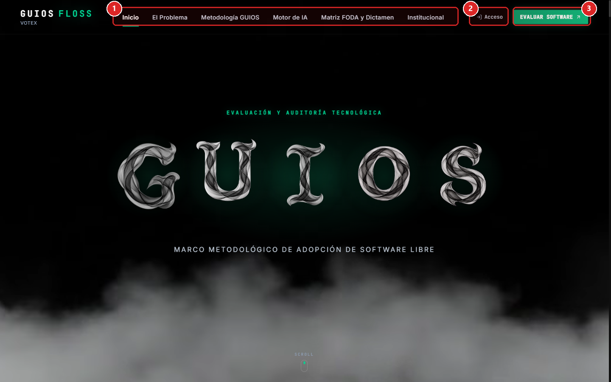

**Figura 1.** Página de inicio de GUIOS PRO: **1.** Enlaces informativos sobre el problema, la metodología GUIOS, el motor de IA y la matriz FODA. **2.** Botón **Acceso** para ingresar al panel administrativo. **3.** Botón destacado **EVALUAR SOFTWARE** para abrir directamente el asistente público de evaluación.

### 2.2 Entrada directa al asistente público de evaluación

Si su objetivo es evaluar un software para su organización, no requiere usuario ni contraseña:

1. Pulse el botón verde **EVALUAR SOFTWARE** en la esquina superior derecha de la portada (indicador **3** en la Figura 1), o navegue directamente a `/evaluar`.
2. El sistema abrirá la pantalla de registro inicial descrita en el [Capítulo 3](#capítulo-3-paso-0-registro-de-la-evaluación-e-historial-local).

### 2.3 Inicio de sesión en el panel administrativo

El personal con cuenta asignada accede al panel administrativo siguiendo estos pasos:

1. En la página de inicio, pulse **Acceso** (indicador **2** en la Figura 1), o diríjase a `/login`.
2. Escriba su **Correo electrónico o nombre de usuario** y su **Contraseña** en los campos señalados (**1**). Puede pulsar el ícono del ojo para verificar lo escrito.
3. Presione **Iniciar sesión** (**2**).

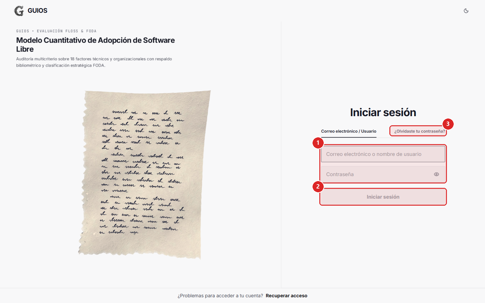

**Figura 2.** Pantalla de acceso (`/login`): **1.** Campos de correo o usuario y contraseña. **2.** Botón **Iniciar sesión**. **3.** Enlace **¿Olvidaste tu contraseña?** para iniciar el restablecimiento de acceso.

### 2.4 Verificación en dos pasos (2FA) y selección de rol

- **Si la cuenta tiene habilitada la verificación en dos pasos (2FA):** tras validar su contraseña, el sistema mostrará un segundo paso solicitando el código temporal de 6 dígitos generado por su aplicación autenticadora (Google Authenticator, Microsoft Authenticator o similar), o bien uno de sus **códigos de recuperación**.
- **Si la cuenta pertenece a más de un rol o grupo:** el sistema abrirá la pantalla de **Selección de rol** (`/select-role`) para que elija con qué perfil desea trabajar en esa sesión. Si la cuenta posee un único rol, entrará directamente al **Dashboard**.

### 2.5 Recuperación de contraseña

Si olvidó su contraseña o perdió acceso a su cuenta:

1. En `/login`, pulse **¿Olvidaste tu contraseña?** (indicador **3** en la Figura 2) o **Recuperar acceso** al pie de la página.
2. Escriba su **Correo electrónico registrado** (**1**).
3. Pulse **Enviar código de verificación** (**2**). El sistema enviará a su correo un código OTP de **6 dígitos** (válido por 30 minutos).
4. Ingrese el código recibido, defina su nueva contraseña y confírmela para regresar al inicio de sesión (**3**).

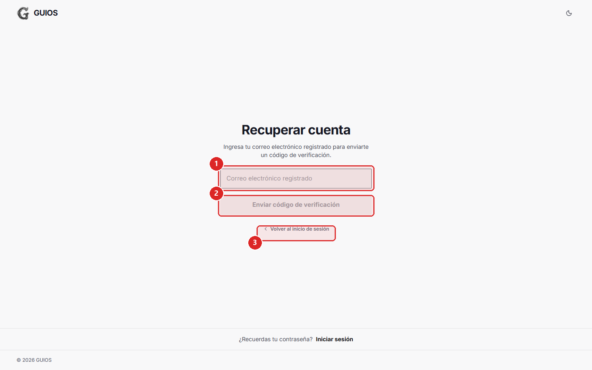

**Figura 3.** Flujo de recuperación de cuenta (`/recuperar-contrasena`): **1.** Campo de correo registrado. **2.** Envío del código de 6 dígitos. **3.** Enlace para regresar al inicio de sesión.

### 2.6 Bloqueo temporal por intentos fallidos y cierre por inactividad

> [!WARNING]
> **Políticas activas de seguridad de sesión:**
> - **Bloqueo por intentos fallidos:** tras **5 intentos consecutivos** con contraseña incorrecta, la cuenta queda bloqueada temporalmente (desde **5 minutos**, escalando progresivamente ante reincidencias) aunque posteriormente ingrese la clave correcta.
> - **Cierre automático por inactividad:** si permanece **30 minutos** continuos sin interacción real (sin clics, desplazamiento ni teclado), la sesión se cerrará automáticamente por seguridad y deberá autenticarse de nuevo.

---

## Capítulo 3. Paso 0: Registro de la Evaluación e Historial Local

### 3.1 Llenado del registro de software y organización

Al entrar al asistente en `/evaluar`, la pantalla se divide en dos columnas: a la izquierda el formulario **Registro del Software Candidato (FLOSS)** (cuyos campos se detallan en la **Tabla 3**) y a la derecha el panel **Evaluaciones Guardadas**.

**Tabla 3.** Campos del formulario de registro inicial de evaluación (Paso 0).

| Campo | Obligatorio | Descripción y recomendación de llenado |
| --- | --- | --- |
| **Nombre del Software** | Sí | Nombre exacto del producto libre a evaluar (ej. `Moodle`). |
| **Versión** | No | Versión o rama analizada (ej. `4.5`). |
| **Categoría Funcional** | Sí | Clasificación operativa del software (ej. `LMS / Plataforma Educativa`, `ERP`, `Base de Datos`). |
| **Organización Evaluadora** | Sí | Nombre de la institución o empresa que evalúa la adopción. |
| **Sector Institucional** | Sí | Sector al que pertenece la organización (ej. `Educación Superior / Universidades`). |
| **Repositorio de Código o Sitio Web** | No *(obligatorio si usa IA sin descripción)* | URL pública en GitHub o GitLab (ej. `https://github.com/moodle/moodle`). Si el sistema lo detecta, muestra la etiqueta **Repositorio detectado** y auditará automáticamente licencia OSI, vitalidad y actividad. |
| **Descripción Técnica y Arquitectura del Software** | No *(recomendado para IA)* | Resumen funcional y técnico para contextualizar mejor las sugerencias de IA. |
| **Necesidades del Entorno Institucional** | No *(recomendado para IA)* | Volumen de usuarios, restricciones de infraestructura o metas de la institución. |

*Fuente: Elaboración propia.*

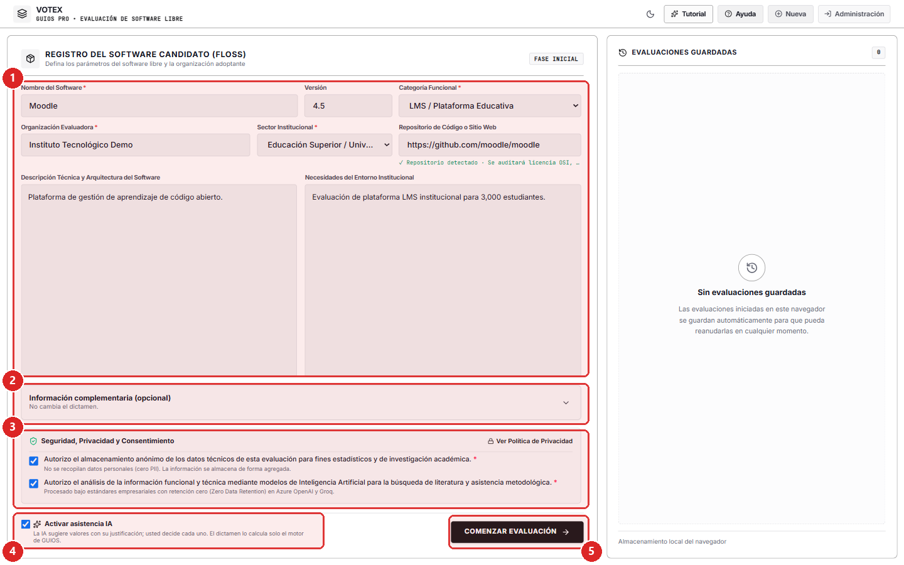

**Figura 4.** Pantalla inicial del asistente (`/evaluar`): **1.** Campos de identificación del software candidato, repositorio y necesidades organizacionales. **2.** Acordeón desplegable **Información complementaria (opcional)**. **3.** Casillas de consentimiento de privacidad y tratamiento técnico. **4.** Interruptor **Activar asistencia IA**. **5.** Botón **COMENZAR EVALUACIÓN**.

### 3.2 Información complementaria opcional

Al hacer clic sobre **Información complementaria (opcional)** (indicador **2** en la Figura 4), se despliegan seis campos contextuales que enriquecen el informe final sin alterar los cálculos ni el dictamen: *Tamaño de la organización*, *Personal de TI*, *Software que se reemplaza*, *Plazo previsto*, *Plataformas actuales* y *Objetivo principal*.

### 3.3 Consentimientos y activación de Inteligencia Artificial

Antes de iniciar la evaluación debe revisar el bloque inferior (**3** y **4** en la Figura 4):

1. Marque la casilla obligatoria de **almacenamiento anónimo de datos técnicos** (**3**, sin recopilación de datos personales).
2. Si desea usar las funciones asistidas por IA, mantenga activa la casilla **Activar asistencia IA** (**4**) y marque también la autorización de **procesamiento mediante modelos de Inteligencia Artificial** (**3**, requiere haber ingresado una URL de repositorio o una descripción del software/necesidad).
3. Pulse **COMENZAR EVALUACIÓN** (**5**) para crear la sesión.

> [!NOTE]
> Puede ejecutar una evaluación **100 % manual sin IA** desmarcando **Activar asistencia IA**. En ese modo se cargan inmediatamente los valores base del catálogo metodológico oficial.

### 3.4 Pantalla de espera («Thinking...») y opción «Continuar sin IA»

Cuando inicia con IA activa, el sistema consulta literatura científica real en **OpenAlex** y calcula la tasa de citación de los 61 subfactores del catálogo. Durante esa espera aparece una cápsula oscura centrada (**Thinking...**).

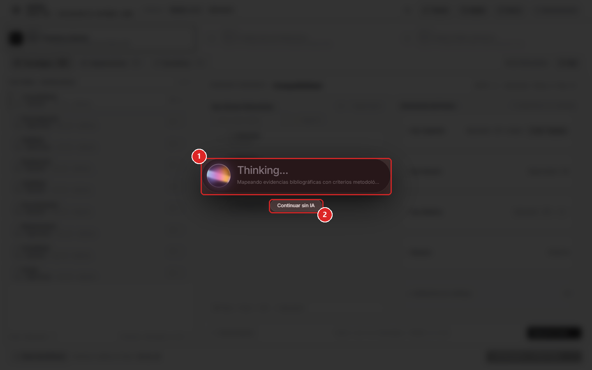

**Figura 5.** Indicador de procesamiento cognitivo: **1.** Cápsula animada **Thinking...** con el estado de la tarea en curso. **2.** Botón **Continuar sin IA** que permite interrumpir la espera en cualquier momento y proseguir con los valores base del catálogo metodológico.

### 3.5 Consultar, retomar o compartir evaluaciones guardadas en el navegador

Toda evaluación que inicie en ese navegador se registra automáticamente en el panel derecho **Evaluaciones Guardadas**, donde puede filtrar por estado (**Todas**, **Con dictamen**, **En curso**), copiar el enlace compartible (`?uuid=...`), eliminarla del historial local o pulsar **Ver** para retomarla exactamente en el paso donde la dejó.

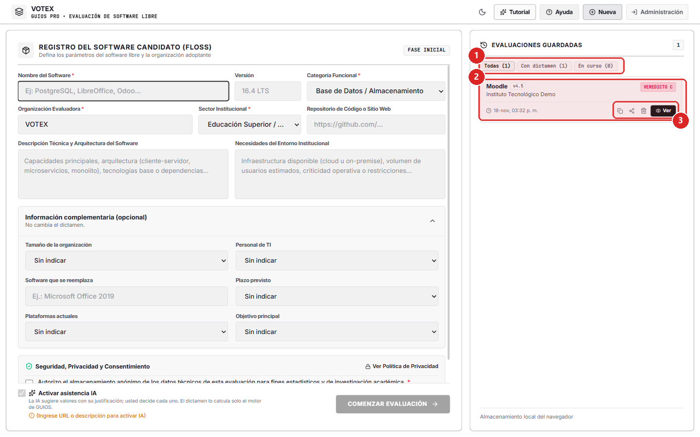

**Figura 6.** Panel lateral de historial en el Paso 0: **1.** Filtros rápidos de estado (`Todas`, `Con dictamen`, `En curso`). **2.** Tarjeta de la evaluación con versión, fecha y badge de dictamen (`VEREDICTO C` o estado en curso). **3.** Accesos rápidos para clonar, copiar enlace de compartir, quitar del historial local o abrir con **Ver**.

---

## Capítulo 4. Paso 1 (Fase 1): Factores, Importancia del Decisor y Relevancia

El objetivo de la **Fase 1** es definir qué importancia tiene cada factor del catálogo para su institución (**ID**) y filtrar cuáles son relevantes (`IR > 1`) para evaluarlos en detalle en la Fase 2.

### 4.1 Estructura de la pantalla de Fase 1

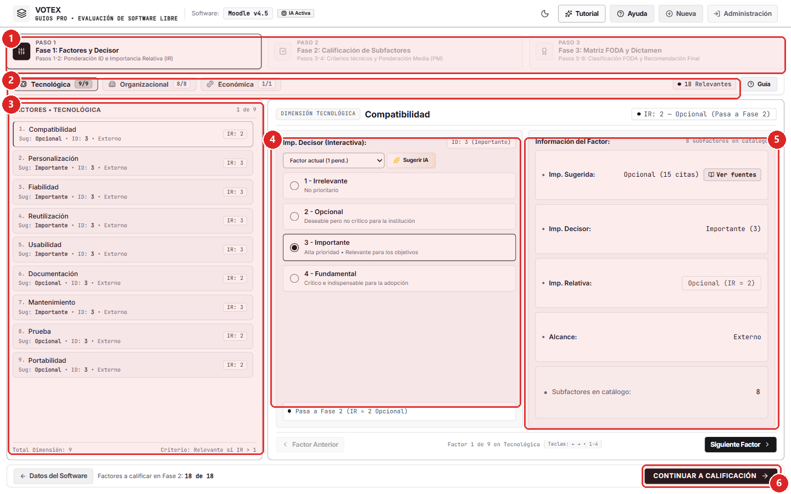

**Figura 7.** Vista completa del Paso 1: **1.** Barra de progreso de los 3 pasos del asistente. **2.** Pestañas de Dimensiones (**Tecnológica**, **Organizacional**, **Económica**), resumen de factores relevantes y botón **Guía**. **3.** Lista de factores de la dimensión seleccionada con su `Sug` (IS), `ID`, ámbito e `IR` actual. **4.** Panel interactivo de **Importancia del Decisor (ID 1 a 4)** con selector de sugerencias de IA. **5.** Panel de **Información del Factor** con acceso a **Ver fuentes**, ámbito y número de subfactores. **6.** Botón **CONTINUAR A CALIFICACIÓN** para guardar los datos y pasar a la Fase 2.

### 4.2 Cómo asignar la Importancia del Decisor (ID) y atajos rápidos

1. Seleccione una dimensión en la parte superior (**2** en la Figura 7) y haga clic en un factor de la lista izquierda (**3**), o navegue con **Factor Anterior** / **Siguiente Factor**.
2. En el panel central (**4**), elija el nivel de **Importancia del Decisor (`ID`)** en escala de 1 a 4:
   - `1 - Irrelevante`: no prioritario para la organización.
   - `2 - Opcional`: deseable, pero no crítico.
   - `3 - Importante`: alta prioridad operativa.
   - `4 - Fundamental`: crítico e indispensable para la adopción.
3. Observe que al cambiar el `ID`, la **Importancia Relativa (`IR`)** se recalcula al instante y el resumen inferior indica **Pasa a Fase 2** o **Descartado (Irrelevante)**.

> [!TIP]
> **Atajos de teclado en Fase 1:** utilice las teclas **`←`** y **`→`** para desplazarse entre factores y las teclas numéricas **`1`**, **`2`**, **`3`** o **`4`** para asignar la Importancia del Decisor sin mover el ratón.

### 4.3 Importancia Sugerida (IS) y consulta de fuentes bibliográficas

En el panel derecho **Información del Factor** (**5** en la Figura 7) se muestra la **Importancia Sugerida (`IS`)** junto al conteo de citas científicas encontradas para el software candidato.

1. Pulse **Ver fuentes** junto a **Imp. Sugerida**.
2. Se abrirá el modal **Literatura Científica Indexada** con la razón bibliográfica ($r_i$), la cantidad de citas auditadas, la importancia literaria (`IL`) y el listado de publicaciones académicas recuperadas desde **OpenAlex** con sus enlaces **DOI** verificables.

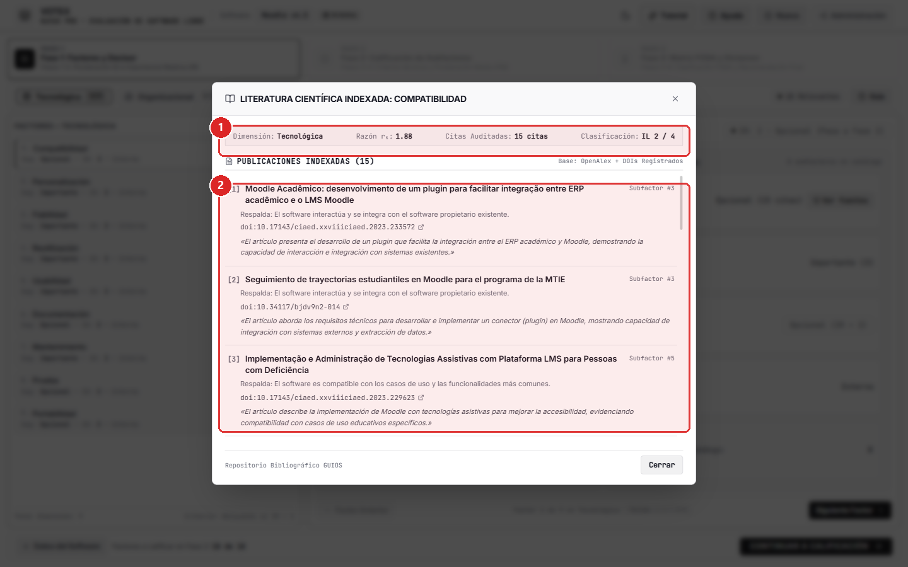

**Figura 8.** Ventana de respaldo bibliográfico: **1.** Indicadores de dimensión, razón $r_i$, citas auditadas y clasificación `IL`. **2.** Publicaciones científicas indexadas por subfactor con DOI navegable y síntesis de respaldo.

### 4.4 Alcance FODA (Interno vs. Externo)

Cada factor posee un **Alcance** predeterminado que determina en qué cuadrantes de la matriz FODA podrá clasificarse:

- **Factores Internos** (ej. *Tiempo de adopción*, *Formación*, *Costos*): clasifican como **Fortaleza** o **Debilidad**.
- **Factores Externos** (ej. *Compatibilidad*, *Fiabilidad*, *Licenciamiento*): clasifican como **Oportunidad** o **Amenaza**.
- **Factor configurable (*Soporte*):** es el único factor del catálogo que permite alternar entre alcance **Interno** (equipo interno de TI) y **Externo** (comunidad o proveedor externo) mediante un selector específico en el panel derecho. Por integridad metodológica, el resto de factores conservan fijo su ámbito oficial.

### 4.5 Selector rápido de sugerencias IA en Fase 1

Si habilitó la asistencia por IA en el Paso 0, encima de las opciones `ID` aparece el selector de alcance de IA (**1** en la Figura 9) junto al botón **Sugerir IA**:

1. Abra el menú desplegable y elija cómo desea solicitar las sugerencias:
   - **Factor actual:** analiza únicamente el factor visible en pantalla.
   - **Dimensión activa** *(ej. Dimensión Tecnológica)*: analiza en lote los factores pendientes de esa dimensión.
   - **Todos los factores:** analiza en lote todos los factores pendientes de la evaluación completa.
2. Pulse **Sugerir IA**. El sistema procesará únicamente los factores pendientes (sin repetir aquellos que ya tengan una sugerencia generada) y mostrará el recuadro **Sugerencia IA** con la justificación debajo de los radios (**2**) y el ícono de estrella junto al nombre en la lista (**3**).
3. Si desea detener un lote en curso, pulse **Detener y revisar avances** en el overlay; las sugerencias ya recibidas permanecerán disponibles en pantalla.

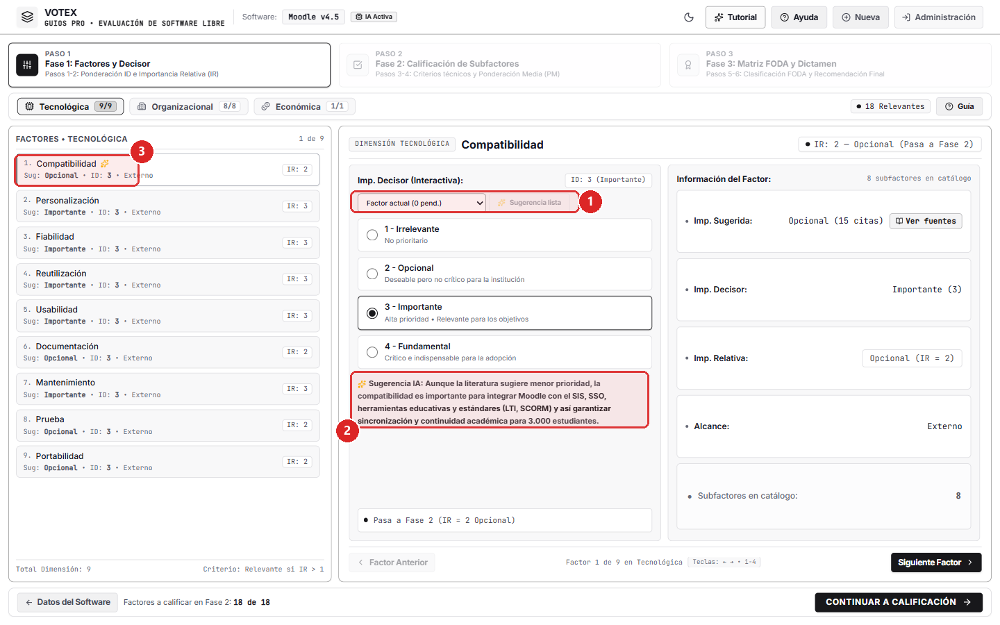

**Figura 9.** Asistencia de IA en Fase 1: **1.** Selector de modo (`Factor actual`, `Dimensión` o `Todos los factores`) con conteo de pendientes y estado **Sugerencia lista**. **2.** Justificación redactada por la IA para apoyar la decisión. **3.** Distintivo visual en el listado lateral indicando qué factor ya cuenta con sugerencia aplicada.

### 4.6 Guía metodológica, tutorial y avance a Fase 2

- En cualquier momento puede pulsar **Guía** (o **Ayuda** en la barra superior) para abrir la explicación resumida de variables (`IS`, `ID`, `IR`, regla de relevancia `IR >= 2`), o **Tutorial** para iniciar el recorrido guiado interactivo sobre los botones reales.
- Cuando haya revisado los factores, pulse **CONTINUAR A CALIFICACIÓN** (**6** en la Figura 7) para guardar la configuración en el servidor y pasar al Paso 2.

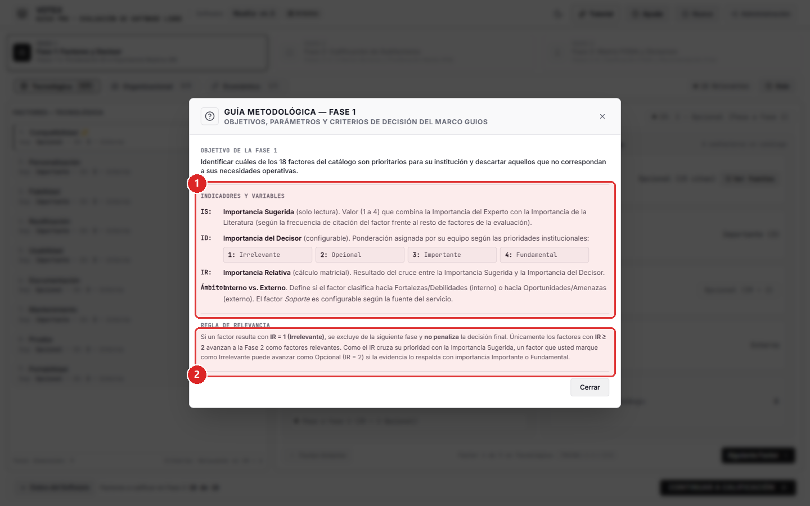

**Figura 10.** Modal **Guía Metodológica — Fase 1**: **1.** Definición práctica de `IS`, escala `ID`, cálculo de `IR` y ámbito. **2.** Explicación de la regla de relevancia (`IR >= 2`) y el motivo por el cual los factores con `IR = 1` se excluyen sin penalizar el dictamen.

---

## Capítulo 5. Paso 2 (Fase 2): Calificación de Subfactores y Ponderación Media (PM)

En la **Fase 2** únicamente aparecen los **factores relevantes (`IR > 1`)** filtrados en el paso anterior. Aquí se califica cada afirmación técnica verificable (subfactor) de 1 a 4 para obtener la Ponderación Media (`PM`) de cada factor.

### 5.1 Estructura de la pantalla de Fase 2

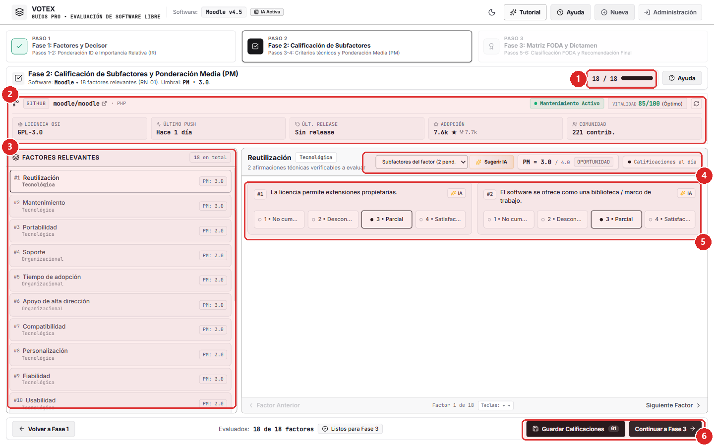

**Figura 11.** Vista general del Paso 2: **1.** Barra de progreso global (`factores completados / total`). **2.** Tarjeta de **Pulso vivo del repositorio FLOSS** (`RepoHealthCard`). **3.** Lista lateral de **Factores Relevantes** con su `PM` calculada o estado pendiente. **4.** Cabecera del factor activo con el selector de sugerencias IA, `PM` en vivo, clasificación FODA preliminar e indicador de cambios pendientes. **5.** Tarjetas de subfactores con botón individual **IA** y opciones de calificación directa `1–4`. **6.** Botón **Guardar Calificaciones** y **Continuar a Fase 3**.

### 5.2 Pulso vivo del repositorio FLOSS

Si registró la URL del repositorio en GitHub o GitLab, la banda superior (**2** en la Figura 11) presenta métricas técnicas objetivas extraídas en vivo:

- **Vitalidad y estado:** puntuación sobre 100 (`Óptimo`, `Activo`, etc.) y estado de mantenimiento.
- **Licencia OSI:** identificador SPDX detectado (ej. `GPL-3.0`, `Apache-2.0`, `MIT`).
- **Último Push y Último Release:** recencia de commits y lanzamientos etiquetados (muestra alerta informativa si no hay releases formales).
- **Adopción y Comunidad:** estrellas, bifurcaciones (*forks*) y número de contribuidores.
- Puede editar o resincronizar la URL desde el botón de actualización de esa misma tarjeta mientras la evaluación siga en curso.

### 5.3 Escala de calificación de criterios verificables

Cada subfactor muestra su afirmación técnica y cuatro botones de selección directa, según la escala definida en la **Tabla 4**:

**Tabla 4.** Escala de calificación de criterios verificables en la Fase 2.

| Valor | Etiqueta | Criterio de aplicación |
| --- | --- | --- |
| **1** | `1 • No cumple` | El software carece del requisito o la evidencia demuestra incumplimiento. |
| **2** | `2 • Desconozco` | No se dispone de información suficiente para verificar el criterio. |
| **3** | `3 • Parcial` | El software satisface el criterio de forma incompleta o condicionada. |
| **4** | `4 • Satisfactorio` | Cumple plenamente con el estándar técnico evaluado. |

*Fuente: Metodología GUIOS / Elaboración propia.*

Al instante, el sistema promedia los subfactores del factor y actualiza la **Ponderación Media (`PM`)** sobre `4.0`. El umbral institucional de aprobación es **`PM ≥ 3.0`**: si alcanza o supera `3.0`, el factor clasifica como **Fortaleza** u **Oportunidad**; si queda por debajo de `3.0`, clasifica como **Debilidad** o **Amenaza**.

### 5.4 Sugerencias de IA en tres modos: individual, por factor o global

En el Paso 2 dispone de tres niveles de velocidad para obtener sugerencias orientativas:

1. **Individual (por un subfactor específico):** haga clic en el botón compacto **IA** ubicado en la esquina superior derecha de la tarjeta del subfactor (**5** en la Figura 11). El sistema propondrá una calificación únicamente para ese criterio sin afectar al resto.
2. **Por factor activo:** en el selector superior (**4** en la Figura 11), mantenga **Subfactores del factor** y pulse **Sugerir IA**. La IA evaluará únicamente los subfactores que aún estén pendientes dentro de ese factor.
3. **Todos los factores relevantes:** seleccione **Todos los factores** en el desplegable y pulse **Sugerir IA**. El asistente evaluará por lotes todos los factores relevantes que tengan criterios pendientes, mostrando el avance en el indicador *Thinking...* y respetando siempre los subfactores que usted ya haya calificado manualmente o sugerido previamente de forma individual.

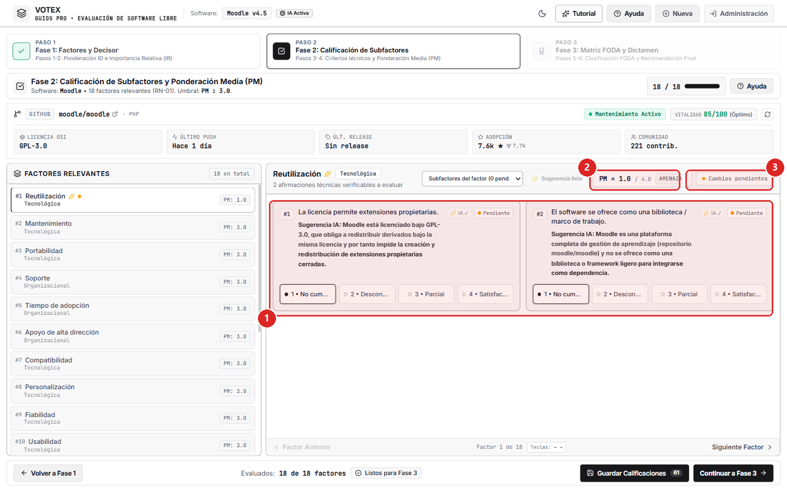

**Figura 12.** Resultado tras aplicar sugerencias de IA en el factor *Reutilización*: **1.** Cada tarjeta muestra el botón marcado **IA ✓**, la etiqueta **Pendiente** de guardado, la justificación técnica de la IA y la nota sugerida preseleccionada. **2.** La `PM` cambia en vivo (`PM = 1.0 / 4.0`) mostrando la clasificación preliminar (`AMENAZA`). **3.** El indicador **Cambios pendientes** recuerda que debe guardar antes de salir.

### 5.5 Guardado manual y bloqueo definitivo antes de pasar a Fase 3

1. Pulse **Guardar Calificaciones** en la barra inferior (**6** en la Figura 11) para persistir sus notas en el servidor. El botón indica cuántas modificaciones pendientes existen. Si intenta retroceder o avanzar con cambios sin guardar, el sistema le advertirá para evitar pérdida de datos.
2. Una vez completados todos los factores relevantes (**Evaluados: X de X factores**), pulse **Continuar a Fase 3**.
3. Aparecerá el diálogo de confirmación **Confirmar Avance a Fase 3 (Dictamen Final)**.

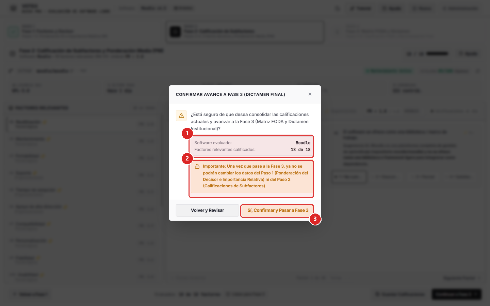

**Figura 13.** Confirmación antes de pasar a la Fase 3: **1.** Verificación de software y cantidad de factores relevantes calificados. **2.** Aviso explícito de que al confirmar, los Pasos 1 y 2 pasarán a modo de **solo lectura**. **3.** Botón **Sí, Confirmar y Pasar a Fase 3** (o **Volver y Revisar** si desea ajustar algo primero).

> [!IMPORTANT]
> Una vez confirmada la entrada a la **Fase 3**, las ponderaciones del Paso 1 y las calificaciones del Paso 2 quedan **bloqueadas permanentemente** (tanto en la pantalla como en la API del servidor) para garantizar la integridad de la auditoría. Si necesita corregir algo después, deberá usar **Re-evaluar** (clonado) desde el Paso 3.

---

## Capítulo 6. Paso 3 (Fase 3): Matriz FODA, Dictamen Oficial y Reportes

### 6.1 Veredicto pendiente y emisión del dictamen oficial

Al ingresar por primera vez a la Fase 3, la pantalla presenta un diagnóstico preliminar calculado sobre los factores registrados, pero el **Dictamen Oficial**, el **Resumen Ejecutivo** y el **Plan de Mitigación** permanecen bloqueados hasta que ejecute formalmente la emisión:

1. Verifique en la barra superior que los Pasos 1 y 2 figuran como **BLOQUEADO • VER** (**1** en la Figura 14).
2. Revise la tarjeta **Veredicto Pendiente** (**2**) y presione **Emitir Dictamen** (disponible en la tarjeta central o en la barra superior).
3. Espere unos segundos mientras se consolida el dictamen determinista y se redactan el resumen ejecutivo y el plan de mitigación.

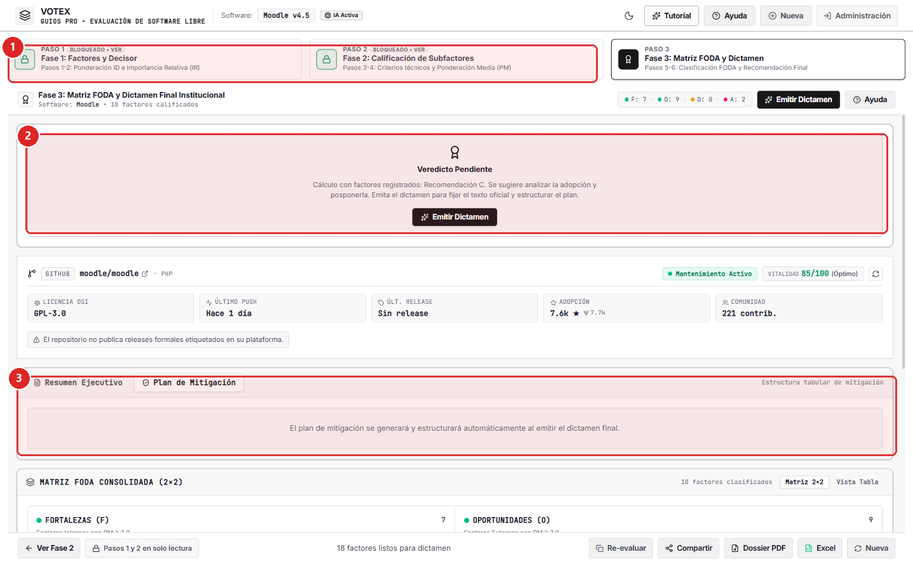

**Figura 14.** Fase 3 con veredicto pendiente: **1.** Pasos 1 y 2 en modo solo lectura. **2.** Tarjeta de **Veredicto Pendiente** con el cálculo preliminar y el botón **Emitir Dictamen**. **3.** Pestaña **Plan de Mitigación** aguardando la emisión formal del veredicto antes de mostrar su estructura.

### 6.2 Interpretación del dictamen (Recomendación A, B o C) y Plan de Mitigación

Tras emitir el dictamen, la tarjeta superior muestra el **Dictamen Oficial GUIOS** (**1** en la Figura 15), cuya recomendación obedece estrictamente a la regla determinista institucional:

- **Recomendación A — Adoptar sin observaciones:** todos los factores relevantes (`IR > 1`) cumplen el umbral (`PM ≥ 3.0`).
- **Recomendación B — Es posible adoptar, con matices:** existen factores relevantes por debajo de `3.0`, pero **todos** son de importancia **Opcional (`IR = 2`)** y su cantidad **no supera** a la cantidad de factores aprobados (`PM ≥ 3.0`).
- **Recomendación C — Se sugiere analizar la adopción y posponerla:** existe al menos un factor bajo el umbral (`PM < 3.0`) con importancia **Importante o Fundamental (`IR ≥ 3`)**, o bien las fallas opcionales (`IR = 2`) superan en número a los factores aprobados. En el ejemplo de Moodle, *Reutilización* (`Amenaza`, `PM: 1.00`, `IR: 3`) determina la **Recomendación C**.

En la pestaña **Plan de Mitigación** (**2** y **3** en la Figura 15) se listan priorizadas únicamente las brechas de factores relevantes por debajo del umbral (`PM < 3.0`), indicando: *Factor / Brecha*, *Riesgo Metodológico*, *Acción Correctiva*, *Responsable* y *Meta de Aprobación*. En la esquina superior derecha de la tabla puede alternar entre vista **Tabla** y vista **Texto**.

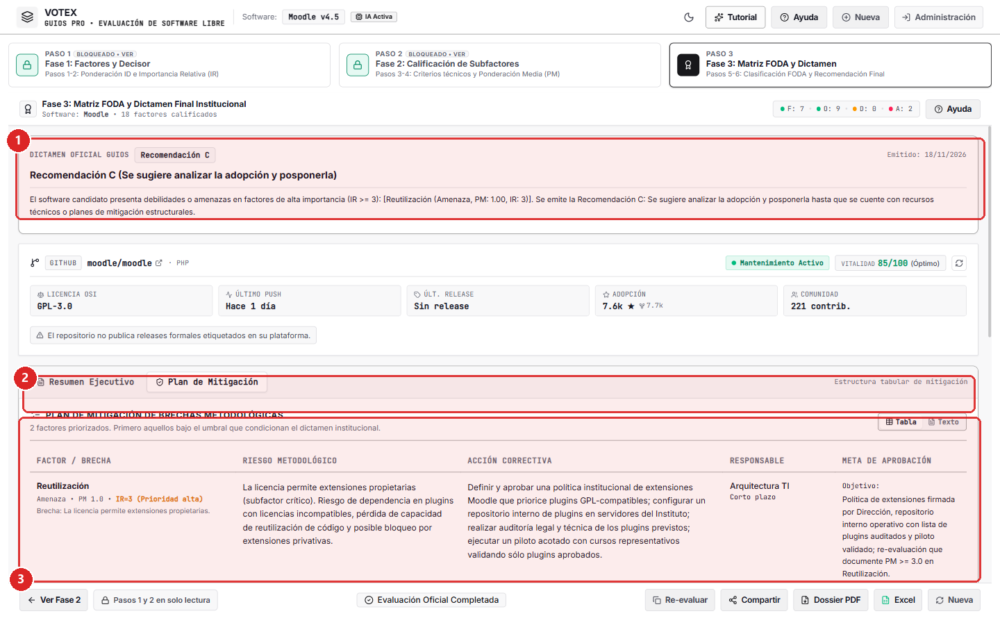

**Figura 15.** Fase 3 consolidada: **1.** Tarjeta del **Dictamen Oficial GUIOS** con código de recomendación, fecha de emisión y explicación exacta de factores críticos. **2.** Pestañas para alternar entre **Resumen Ejecutivo** y **Plan de Mitigación**. **3.** Tabla estructurada de brechas priorizadas con responsables, metas de aprobación y conmutador **Tabla / Texto**.

### 6.3 Lectura del Resumen Ejecutivo

Haga clic en la pestaña **Resumen Ejecutivo** (**1** en la Figura 16) para consultar la síntesis directiva redactada para la alta gerencia (**2**), donde se detallan los factores que sostienen la adopción, las brechas que la condicionan y la conclusión operativa.

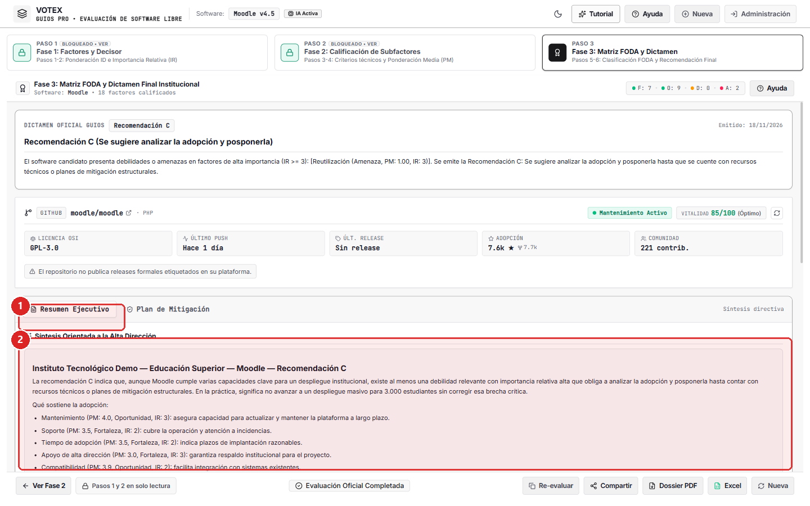

**Figura 16.** Vista de síntesis directiva: **1.** Pestaña activa **Resumen Ejecutivo**. **2.** Documento Markdown saneado y formateado con los hallazgos clave del software evaluado.

### 6.4 Matriz FODA Consolidada, exportación (PDF/Excel), compartir y re-evaluar

#### 6.4.1 Matriz FODA 2×2, compartición y re-evaluación

En la parte inferior de la Fase 3 se ubica la **Matriz FODA Consolidada (2×2)** junto con las opciones de cierre y exportación:

1. Alterne entre **Matriz 2×2** y **Vista Tabla** (**1** en la Figura 17).
2. En los cuadrantes **Fortalezas (F)**, **Oportunidades (O)**, **Debilidades (D)** y **Amenazas (A)** (**2**), puede hacer clic sobre cualquier factor para inspeccionar en modo **Solo lectura** los subfactores calificados en la Fase 2.
3. En la barra inferior derecha (**3**) dispone de cinco acciones clave:
   - **Re-evaluar:** clona la evaluación actual en una nueva sesión en progreso para evaluar otra versión o escenario sin alterar el historial oficial.
   - **Compartir:** copia el enlace directo con el UUID público de la evaluación para que cualquier miembro del equipo pueda abrir y consultar el dictamen.
   - **Dossier PDF:** descarga el informe técnico completo en formato PDF institucional.
   - **Excel:** descarga el libro metodológico en formato `.xlsx` con hojas detalladas de resumen, factores, subfactores, FODA y trazabilidad.
   - **Nueva:** regresa al Paso 0 para iniciar otra evaluación (conservando la actual en el historial local).

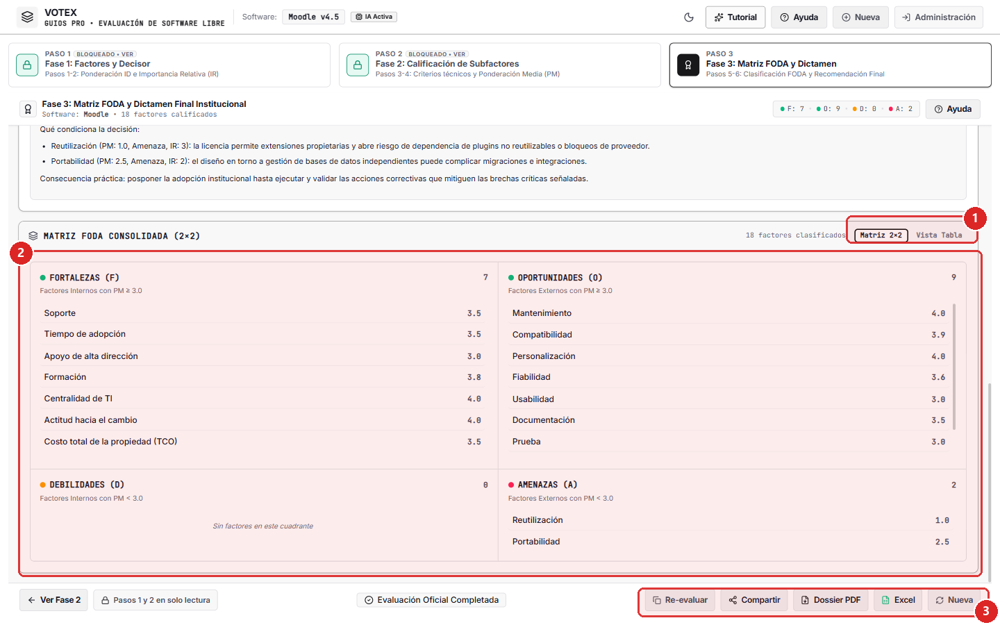

**Figura 17.** Cierre de la evaluación: **1.** Conmutador entre **Matriz 2×2** y **Vista Tabla**. **2.** Cuatro cuadrantes FODA con la `PM` de cada factor (clicables para inspección). **3.** Acciones de cierre: **Re-evaluar**, **Compartir**, **Dossier PDF**, **Excel** y **Nueva**.

#### 6.4.2 Exportación del Dossier PDF oficial y libro Excel

Al pulsar **Dossier PDF**, el sistema genera y descarga un expediente institucional multipágina (por ejemplo, de 22 páginas para Moodle) que consolida portada técnica, dictamen, ficha de calibración cuartílica, gráficos comparativos, matriz FODA y detalle completo por factor y subfactor:

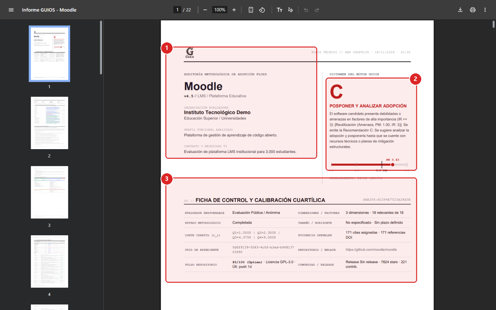

**Figura 18.** Primera página del **Dossier PDF** descargado: **1.** Encabezado editorial con identificación del software evaluado y necesidades de la institución. **2.** Bloque de dictamen oficial y barra gráfica de posición frente al umbral `3.0`. **3.** **Ficha de Control y Calibración Cuartílica** con cortes `Q1–Q4`, citas OpenAlex, UUID y pulso del repositorio.

---

## Capítulo 7. Panel Administrativo: Catálogo Metodológico y Evaluaciones

El personal autenticado accede al panel de gestión mediante `/login`. La barra lateral izquierda muestra únicamente los módulos habilitados para el rol del usuario activo.

### 7.1 Dashboard ejecutivo

Al iniciar sesión, la pantalla principal (**Dashboard**) consolida las métricas globales de todas las evaluaciones registradas en la plataforma.

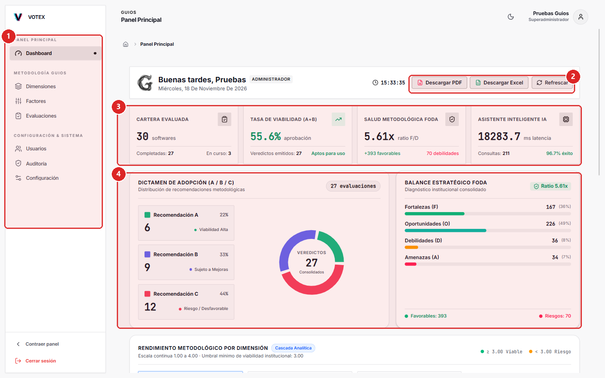

**Figura 19.** Parte superior del Dashboard: **1.** Menú lateral con acceso a módulos metodológicos y de configuración. **2.** Botones para **Descargar PDF**, **Descargar Excel** de cartera general o **Refrescar** datos. **3.** Tarjetas KPI globales (cartera evaluada, tasa de viabilidad `A+B`, salud FODA y rendimiento del asistente IA). **4.** Gráfico circular de distribución de dictámenes (**A / B / C**) y barras horizontales del **Balance Estratégico FODA**.

Al desplazarse hacia abajo en el Dashboard se observa el rendimiento promedio de cada dimensión respecto al umbral viable (`3.00`) y la tabla de acceso rápido a las evaluaciones completadas.

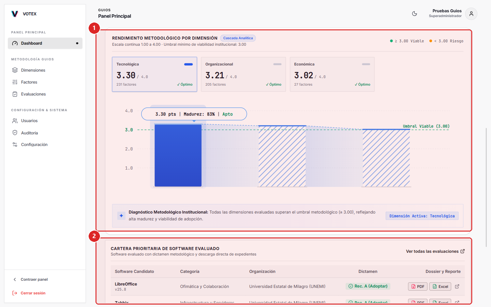

**Figura 20.** Sección analítica inferior del Dashboard: **1.** Cascada analítica por dimensión (**Tecnológica**, **Organizacional**, **Económica**) contrastada contra el umbral `3.00`. **2.** Cartera prioritaria de software evaluado con descarga directa de expedientes PDF y Excel.

### 7.2 Gestión de Dimensiones

En **Metodología GUIOS → Dimensiones** (`/dashboard/guios/dimensiones`) se administran las áreas de primer nivel de la guía:

1. Pulse **+ Nueva Dimensión** (**1** en la Figura 21) si requiere añadir una dimensión personalizada adicional a las tres base oficiales de la tesis.
2. Utilice el buscador y los filtros (**Todas**, **Base Oficial**, **Personalizadas**) (**2**).
3. En la tabla (**3**) puede consultar el detalle (ícono de ojo), editar nombre/descripción o eliminar dimensiones personalizadas.

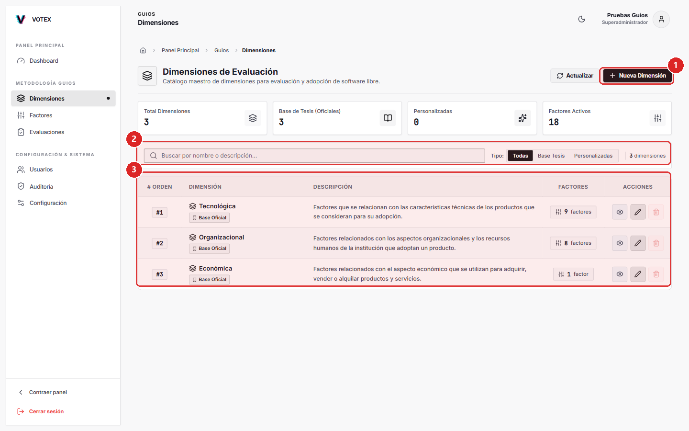

**Figura 21.** Administración de Dimensiones: **1.** Botón para crear una nueva dimensión. **2.** Barra de búsqueda y filtro por origen. **3.** Listado con orden, cantidad de factores asociados y botones de acción.

### 7.3 Gestión de Factores y Subfactores

El módulo **Metodología GUIOS → Factores** (`/dashboard/guios/factores`) unifica mediante dos pestañas (**1** en la Figura 22) la gestión del catálogo completo:

#### 7.3.1 Pestaña Factores

Permite crear o editar factores, asociarlos a una dimensión, definir su **Alcance** (`Interno`, `Externo` o `Configurable`), ajustar su **Importancia Sistémica (`IS`)**, **Experto (`IE`)** y **Literatura (`IL`)** y consultar cuántos subfactores contiene (**2** en la Figura 22).

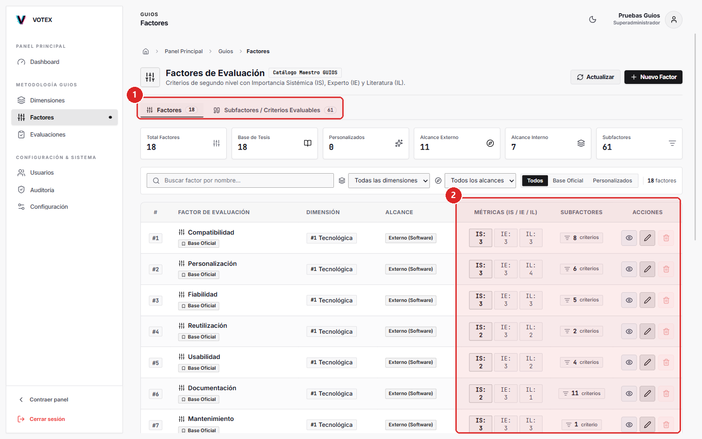

**Figura 22.** Pestaña de Factores: **1.** Selector entre **Factores** y **Subfactores / Criterios Evaluables**. **2.** Columnas de métricas (`IS`, `IE`, `IL`), conteo de criterios y acciones de edición.

#### 7.3.2 Pestaña Subfactores / Criterios Evaluables

Administra las afirmaciones verificables de tercer nivel evaluadas en escala `1–4` (**61 criterios** en el catálogo base). Permite filtrar por dimensión, factor, origen y estado (**1** en la Figura 23), así como revisar o ajustar la afirmación técnica, las **Citas Base (`CI`)** y las **Palabras Clave IA** (**2**) que orientan las consultas bibliográficas.

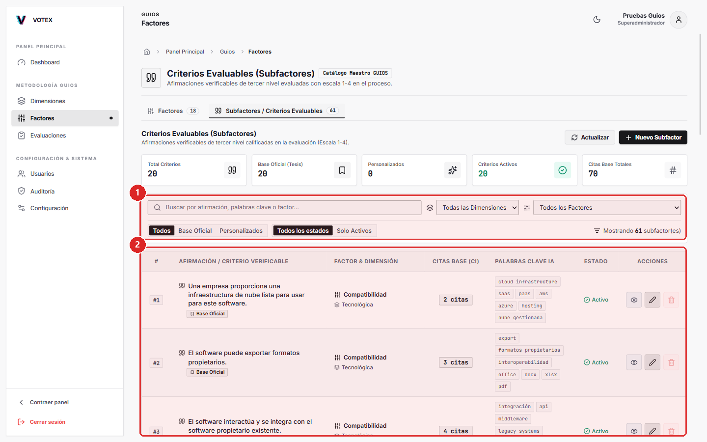

**Figura 23.** Pestaña de Subfactores: **1.** Filtros combinados por texto, dimensión, factor, origen y estado activo. **2.** Listado de afirmaciones verificables con sus citas base, palabras clave para IA y acciones por fila.

### 7.4 Listado de Evaluaciones, detalle técnico y auditoría de IA

#### 7.4.1 Listado general y selección para comparación

En **Metodología GUIOS → Evaluaciones** (`/dashboard/guios/evaluaciones`) se centralizan todas las evaluaciones creadas tanto desde el módulo público como desde el panel administrativo:

1. Desde la cabecera (**1** en la Figura 24) puede abrir el **Módulo Público** o consultar la **Auditoría IA** global.
2. Filtre por texto, estado metodológico (`Completada` / `En Progreso`) o categoría funcional (**2**).
3. En cada fila (**3**) dispone de la casilla izquierda para seleccionar **2 evaluaciones a comparar**, además de accesos directos para abrir el detalle completo, descargar **PDF**, exportar **Excel**, revisar **Logs IA**, abrir en el asistente o eliminar.

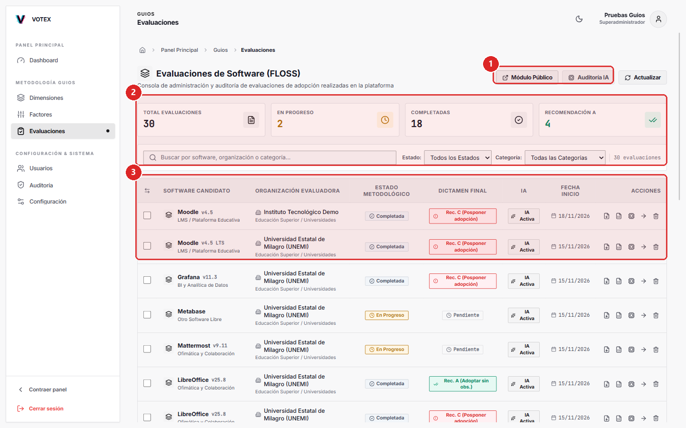

**Figura 24.** Listado administrativo de evaluaciones: **1.** Accesos superiores a **Módulo Público** y **Auditoría IA**. **2.** Tarjetas KPI de resumen y filtros de búsqueda. **3.** Selector para comparación y botones de acción por evaluación.

#### 7.4.2 Pestaña Resolución y Matriz FODA

Al hacer clic sobre una evaluación (por ejemplo, **Moodle v4.5**), se abre su **Expediente de Detalle Técnico** (`/dashboard/guios/evaluaciones/:id`) compuesto por **cinco pestañas especializadas**; la primera presenta la resolución oficial vinculante, la ficha del repositorio y la matriz FODA:

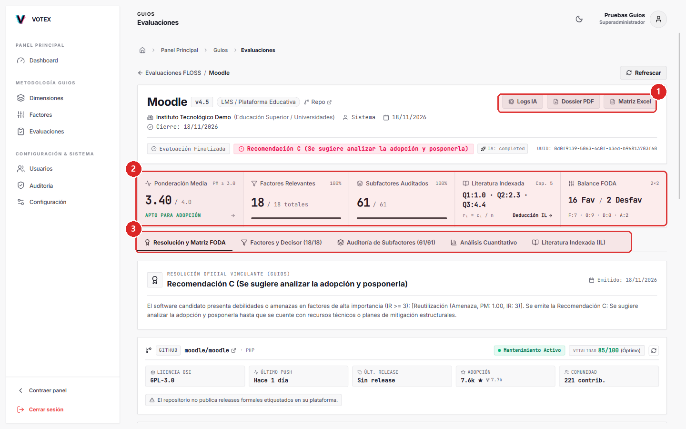

**Figura 25.** Vista general del detalle administrativo: **1.** Botones superiores para abrir **Logs IA**, **Dossier PDF** y **Matriz Excel**. **2.** Cinco tarjetas consolidadas con Ponderación Media global, factores relevantes, subfactores auditados, cuartiles de literatura (`Q1`, `Q2`, `Q3`) y balance FODA. **3.** Cinco pestañas navegables (**Resolución y Matriz FODA**, **Factores y Decisor**, **Auditoría de Subfactores**, **Análisis Cuantitativo** y **Literatura Indexada (IL)**).

#### 7.4.3 Pestaña Factores y Decisor

Permite filtrar entre todos los factores, relevantes o descartados (**1** en la Figura 26) y auditar la fórmula `IS = M(IE, IL)`, la razón $r_i$ y citas DOI, la prioridad `ID`, la `IR` resultante y el ámbito (**2**).

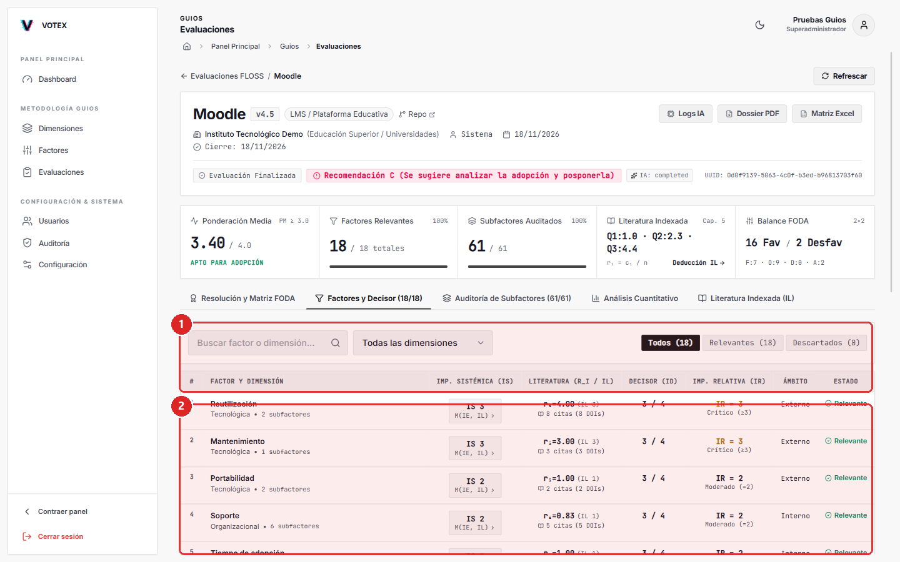

**Figura 26.** Trazabilidad de Fase 1 en el expediente: **1.** Buscador, filtro por dimensión y pestañas de estado (`Todos`, `Relevantes`, `Descartados`). **2.** Desglose completo de `IS`, razón literaria `r_i / IL`, `ID`, `IR`, ámbito y relevancia.

#### 7.4.4 Pestaña Auditoría de Subfactores

Muestra el desglose matemático de cada factor (expandible o colapsable, **1** en la Figura 27), la fórmula exacta de `PM`, su escala contra el umbral `3.0` y el detalle de cada criterio calificado con su justificación de IA (**2**).

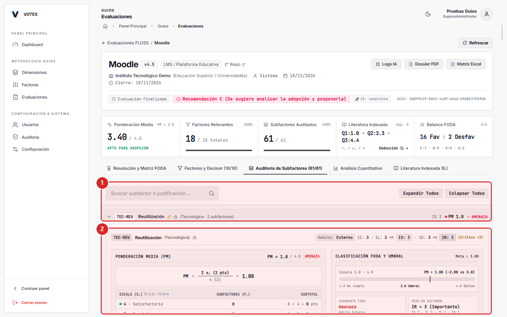

**Figura 27.** Auditoría granular de subfactores: **1.** Buscador de subfactores/justificaciones y controles **Expandir Todos / Colapsar Todos**. **2.** Cálculo explícito de `PM`, desglose por nivel y barra de posición frente al umbral `3.0`.

#### 7.4.5 Pestaña Análisis Cuantitativo

Ofrece métricas estadísticas consolidadas de cumplimiento (**1** en la Figura 28), barra proporcional de respuestas en escala `1–4` (**2**) y dispersión cuantitativa por dimensión (**3**).

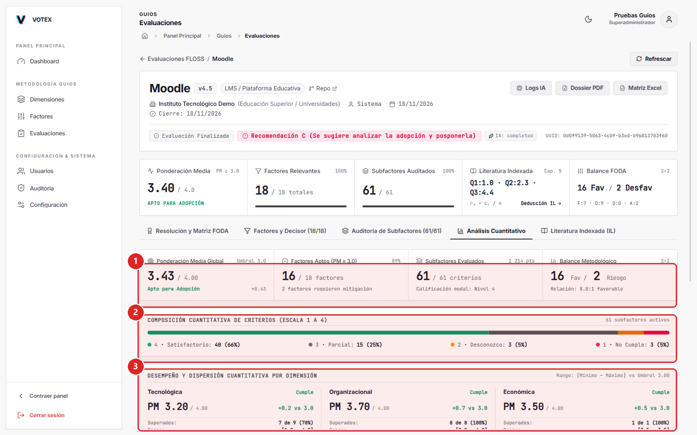

**Figura 28.** Analítica cuantitativa de la evaluación: **1.** Tarjetas de promedio global, tasa de aprobación, total de criterios y balance favorable/riesgo. **2.** Distribución porcentual de notas (`4`, `3`, `2`, `1`). **3.** Desempeño comparativo y dispersión por dimensión.

#### 7.4.6 Pestaña Literatura Indexada (IL)

Documenta paso a paso la formulación matemática del Capítulo 5 de la guía GUIOS (**1** en la Figura 29), mostrando la razón de citación ($r_i = c_i / n$) y la deducción exacta de los límites cuartílicos `Q1–Q4` mediante interpolación lineal Tipo 7 (**2**).

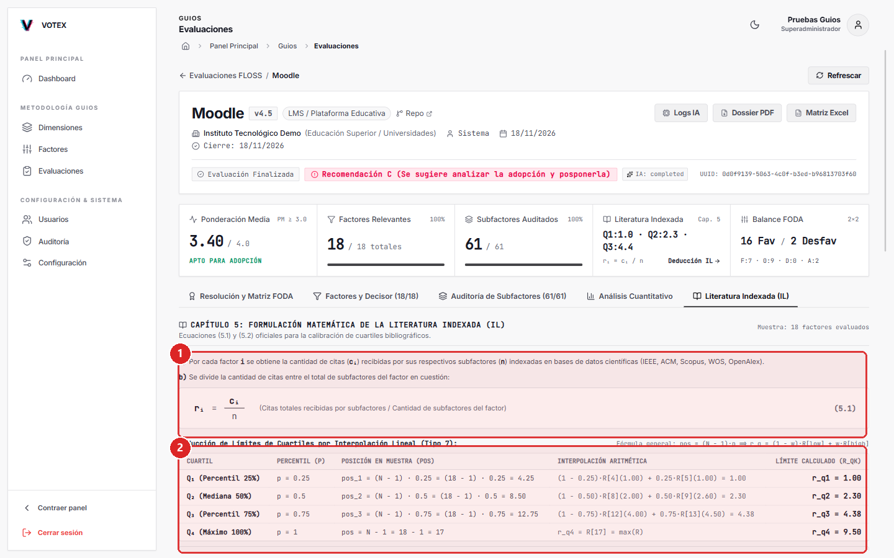

**Figura 29.** Auditoría bibliométrica oficial: **1.** Ecuación (5.1) para calcular la tasa promedio de citas por factor. **2.** Tabla dinámica de límites de cuartiles (`Q1`, `Q2`, `Q3`, `Q4`) calculados para el software evaluado.

#### 7.4.7 Visor de Logs y Auditoría de IA

Al pulsar **Logs IA** (**1** en la Figura 25), se abre el visor de **Auditoría IA** con la trazabilidad completa de todas las llamadas realizadas a los modelos LLM o contingencia heurística durante esa evaluación:

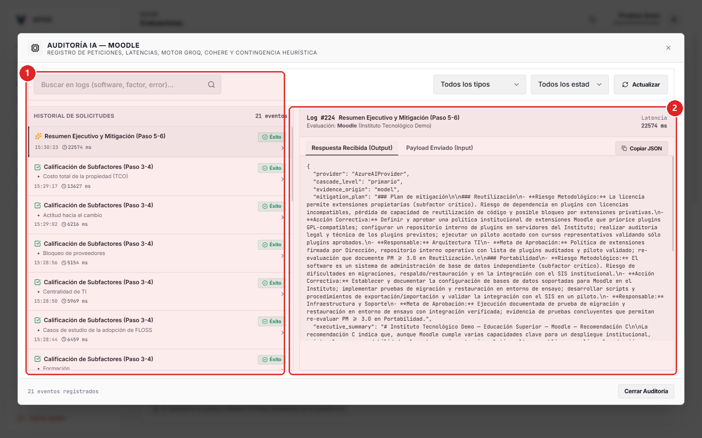

**Figura 30.** Modal **Auditoría IA**: **1.** Filtros y lista cronológica de solicitudes con latencia en milisegundos y estado (`Éxito` / error). **2.** Inspector estructurado con las pestañas **Respuesta Recibida (Output)**, **Payload Enviado (Input)** y botón **Copiar JSON**.

### 7.5 Comparación de evaluaciones

Puede comparar dos evaluaciones (por ejemplo, dos versiones del mismo software o dos candidatos alternativos como *Moodle 4.5* frente a *LibreOffice 25.8*) marcando sus casillas en el listado y pulsando **Comparar**:

1. En la barra superior (**1** en la Figura 31) puede **Invertir** el orden (*Antes / Después*), alternar entre vista **Lado a Lado** y **Matriz Delta**, activar **Ocultar sin cambios** o **Imprimir**.
2. El bloque superior de métricas (**2**) resume la **Transición de Dictamen** (`C → A`), el cambio de `PM` promedio global y el conteo de mejoras y retrocesos.
3. En la sección central (**3**) puede recorrer factor por factor el análisis comparativo detallado o saltar directo mediante los chips inferiores.

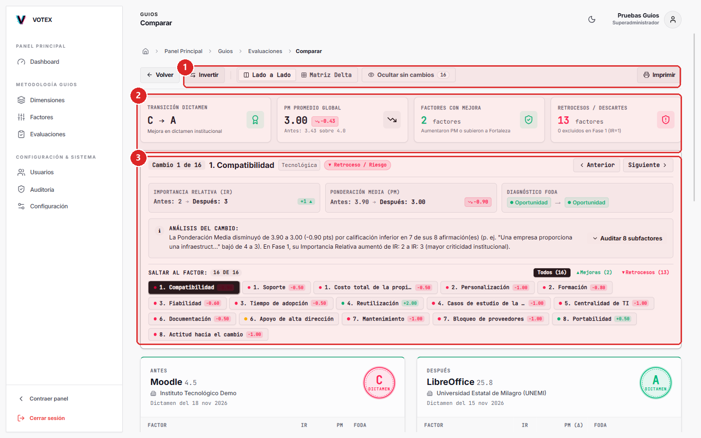

**Figura 31.** Pantalla de comparación (`/dashboard/guios/evaluaciones/comparar`): **1.** Controles de dirección, vista e impresión. **2.** Tarjetas de transición de dictamen y variación global. **3.** Análisis guiado factor por factor y chips de navegación rápida.

---

## Capítulo 8. Administración del Sistema, Seguridad y Perfil

### 8.1 Gestión de usuarios

En **Configuración & Sistema → Usuarios** (`/dashboard/users`) el administrador controla las cuentas con acceso al panel:

1. Use el campo de búsqueda o pulse **+ Nuevo** (**1** en la Figura 32) para registrar un usuario, definir sus datos de contacto y asignarle uno o varios roles.
2. En la tabla (**2**) puede inspeccionar el perfil completo del usuario, activar o suspender su acceso (botón de encendido verde/rojo), editar sus datos o eliminarlo.

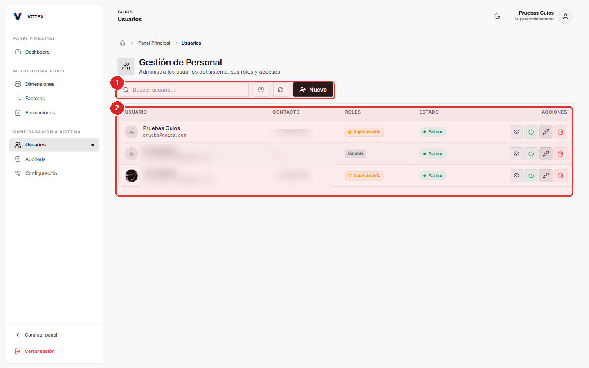

**Figura 32.** Módulo de Usuarios (datos personales de terceros difuminados por privacidad): **1.** Buscador, ayuda y botón **+ Nuevo**. **2.** Listado de cuentas con rol asignado, estado (**Activo** / inactivo) y acciones por usuario.

### 8.2 Registro de auditoría del sistema

En **Configuración & Sistema → Auditoría** (`/dashboard/auditoria`) se registra de forma inmutable cada creación, edición o eliminación ejecutada en el sistema (ya sea por un usuario o mediante señales automáticas del motor metodológico).

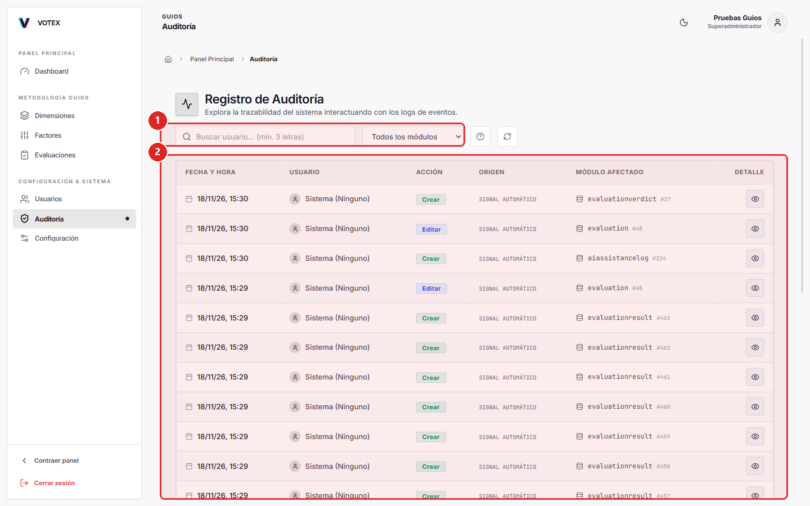

**Figura 33.** Trazabilidad del sistema: **1.** Filtro por usuario (mínimo 3 caracteres) y selector de módulo afectado. **2.** Tabla cronológica con fecha y hora, autor, acción (`Crear`, `Editar`), origen (`SIGNAL AUTOMÁTICO` o manual), entidad afectada y botón **Detalle** para revisar el contenido del evento.

### 8.3 Configuración institucional: Organización, Roles y Menú

Dentro de **Configuración & Sistema → Configuración** (`/dashboard/configuracion`) existen tres secciones bajo **Empresa** (navegables desde el submenú **1** en la Figura 34):

#### 8.3.1 Organización

En `/dashboard/configuracion/organizacion` se administra la identidad visible del sistema y los reportes (logotipo, nombre, eslogan, RUC, teléfono, correo y dirección institucional), aplicando los ajustes con **Guardar cambios** (**2** en la Figura 34).

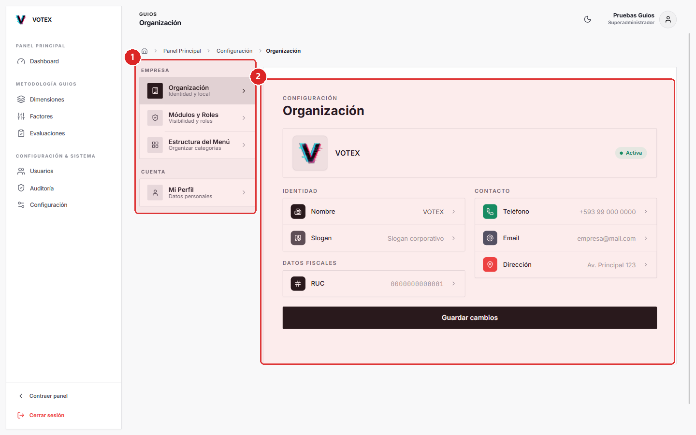

**Figura 34.** Parámetros de Organización: **1.** Submenú de configuración (**Organización**, **Módulos y Roles**, **Estructura del Menú** y **Mi Perfil**). **2.** Formulario de identidad, datos fiscales, contacto y botón **Guardar cambios**.

#### 8.3.2 Módulos y Roles

En `/dashboard/configuracion/permisos` es posible crear nuevos roles (**+ Nuevo rol**, **1** en la Figura 35) y activar o desactivar mediante interruptores (**2**) el acceso granular a cada módulo y permiso interno (por ejemplo `dashboard.view`, `dashboard.export_report`, `guios.dimension_view`), finalizando con **Guardar**.

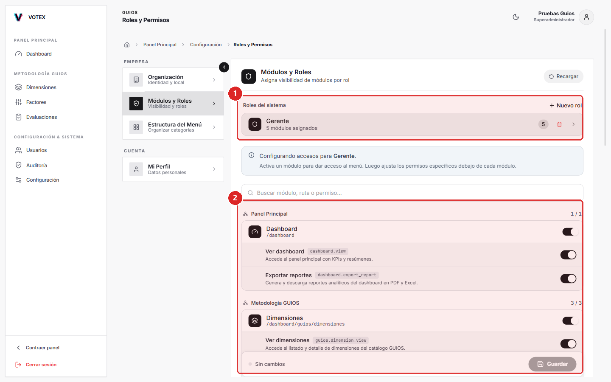

**Figura 35.** Administración de Roles y Permisos: **1.** Selector de rol y creación de nuevos grupos. **2.** Interruptores de visibilidad por módulo y permisos específicos con buscador y barra inferior **Guardar**.

#### 8.3.3 Estructura del Menú

En `/dashboard/configuracion/menu` se reorganiza mediante arrastrar y soltar el orden de categorías e ítems del menú lateral izquierdo (**2** en la Figura 36), editar etiquetas y sincronizar nuevos módulos registrados con **Sincronizar** (**1**).

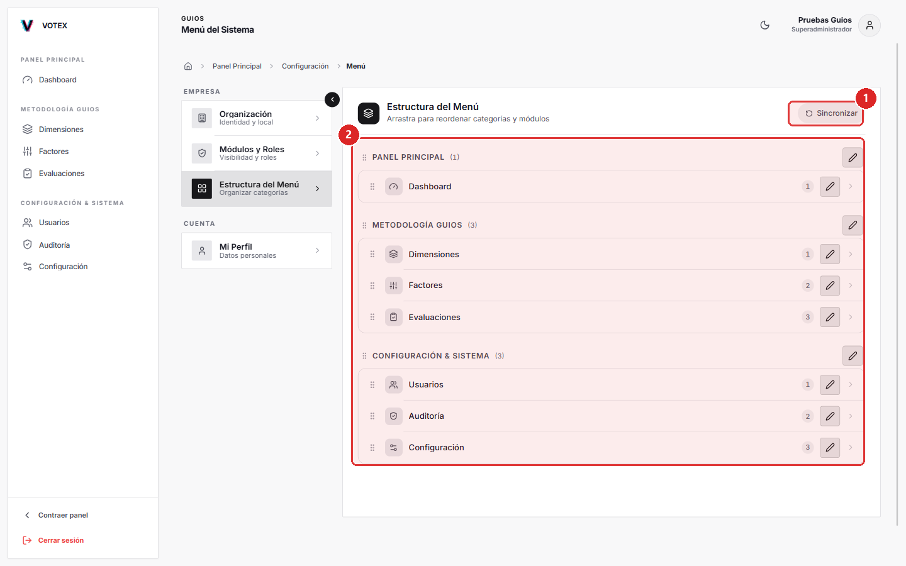

**Figura 36.** Estructura del Menú (`/dashboard/configuracion/menu`): **1.** Botón **Sincronizar**. **2.** Tarjetas reordenables por categoría (`PANEL PRINCIPAL`, `METODOLOGÍA GUIOS`, `CONFIGURACIÓN & SISTEMA`).

### 8.4 Mi Perfil, cambio de contraseña y autenticación en dos pasos (2FA)

Desde el menú lateral **Configuración → Mi Perfil** (o haciendo clic en su nombre en la esquina superior derecha), cada usuario accede a su ficha personal y controles de seguridad:

1. Consulte su índice de confianza GUIOS, rendimiento operativo, historial personal de actividad, evaluaciones propias y permisos asignados mediante las pestañas centrales (**1** en la Figura 37).
2. Seleccione la pestaña **Seguridad & 2FA** (**1**) para administrar su protección de cuenta:
   - **Autenticación de dos pasos (2FA):** active el interruptor (**2**) para vincular una aplicación TOTP mediante código QR, confirmar su primer código de 6 dígitos y descargar sus **códigos de recuperación en PDF** por si pierde acceso al teléfono.
   - **Credenciales de Acceso:** pulse **Cambiar Contraseña** (**3**) para actualizar su clave (si tiene 2FA activo, el formulario le solicitará el código de 6 dígitos para confirmar el cambio).

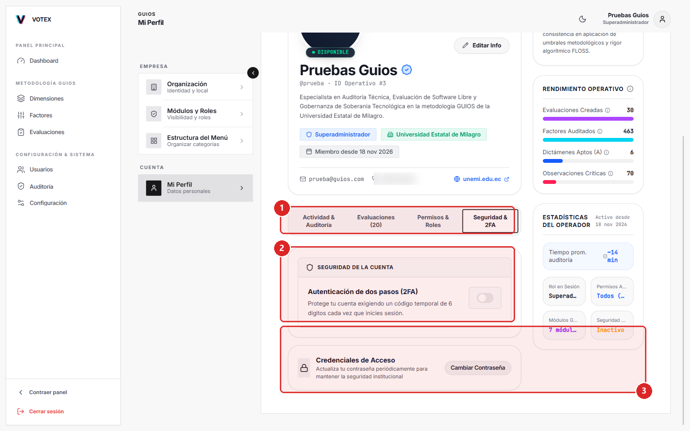

**Figura 37.** Seguridad de la cuenta en **Mi Perfil**: **1.** Pestañas de perfil con **Seguridad & 2FA** activa. **2.** Interruptor para activar o desactivar la autenticación en dos pasos (2FA). **3.** Botón **Cambiar Contraseña** y tarjeta resumen con el estado de seguridad del operador.

---

## Capítulo 9. Preguntas Frecuentes y Solución de Problemas

La **Tabla 5** recopila las incidencias más frecuentes durante el uso del asistente público y del panel administrativo, junto con su causa probable y solución recomendada.

**Tabla 5.** Guía rápida de preguntas frecuentes y solución de problemas operativos.

| Situación / Síntoma | Causa probable | Solución recomendada |
| --- | --- | --- |
| **El interruptor «Activar asistencia IA» aparece bloqueado en el Paso 0.** | No se ingresó una URL de repositorio ni descripción del software/necesidad. | Escriba la URL de GitHub/GitLab o complete al menos una breve descripción técnica o de necesidades institucionales en el Paso 0. |
| **La pantalla «Thinking...» demora demasiado en el Paso 0.** | La búsqueda en OpenAlex o el proveedor de IA está saturado o sin respuesta temporal. | Pulse **Continuar sin IA** debajo de la cápsula **Thinking...** para cargar inmediatamente los valores base del catálogo y proseguir manualmente. |
| **En el Paso 1 no puedo cambiar el alcance FODA de un factor (ej. Compatibilidad).** | Solo los factores marcados como configurables en la metodología (como *Soporte*) admiten cambio entre Interno y Externo. | Comportamiento esperado por integridad metodológica (RN de FODA por ámbito); el resto de factores mantienen fijo su alcance oficial. |
| **El botón «Emitir Dictamen» falla o indica factores relevantes sin calificar.** | Al menos un factor con `IR > 1` no tiene calificación guardada en el Paso 2. | Vuelva al Paso 2, verifique en la lista izquierda que ningún factor figure como **Pendiente**, pulse **Guardar Calificaciones** y regrese a Fase 3. |
| **En el Paso 3 no aparece el Plan de Mitigación ni el Resumen Ejecutivo.** | Aún no se ha emitido formalmente el dictamen oficial. | Pulse **Emitir Dictamen** en la tarjeta central o superior; tras completarse, se habilitarán el dictamen oficial, el resumen y la tabla de mitigación. |
| **No puedo modificar el Paso 1 o Paso 2 tras entrar a Fase 3.** | Al confirmar el paso a Fase 3, las Fases 1 y 2 se bloquean para proteger el dictamen emitido. | Si necesita evaluar cambios o una nueva versión, utilice **Re-evaluar** en la barra inferior del Paso 3 para clonar los datos en una nueva evaluación. |
| **Un factor con `IR = 1` no aparece en el Paso 2 ni en el Plan de Mitigación.** | En GUIOS, `IR = 1` significa *Irrelevante (Descartado)* y no interviene en las fases siguientes. | Comportamiento correcto según la regla de relevancia (`RN-01`). Si sí desea evaluarlo, aumente su `ID` en el Paso 1 (antes de bloquear en Fase 3). |
| **Al entrar a `/login` aparece aviso de sesión expirada por inactividad.** | Transcurrieron 30 minutos sin actividad del usuario en el panel administrativo. | Inicie sesión nuevamente. Para mayor seguridad, cierre sesión manualmente al terminar en equipos compartidos. |
| **Error «Demasiados intentos fallidos» al iniciar sesión.** | Se superaron 5 intentos consecutivos con contraseña errónea. | Espere el tiempo de bloqueo temporal (mínimo 5 minutos) o utilice **¿Olvidaste tu contraseña?** para restablecer su clave. |
| **No llega el correo de recuperación de contraseña.** | Correo no registrado, bandeja de spam o servicio SMTP temporalmente no disponible. | Verifique la carpeta de correo no deseado; si aparece un mensaje de servicio no disponible, contacte al administrador del sistema. |

*Fuente: Elaboración propia.*

---

## Apéndice A. Referencia Metodológica Rápida

### A.1 Matriz de Combinación de Importancias (`IS = M(IE, IL)` e `IR = M(ID, IS)`)

GUIOS utiliza la misma matriz determinista de 4×4 en dos momentos:
1. Para calcular la **Importancia Sugerida (`IS`)** combinando la Importancia del Experto (`IE`) con la Importancia de Literatura (`IL`).
2. Para calcular la **Importancia Relativa (`IR`)** combinando la Importancia del Decisor (`ID`, filas) con la Importancia Sugerida (`IS`, columnas), conforme a la **Tabla 6**:

**Tabla 6.** Matriz de combinación de importancias 4×4 (`IS = M(IE, IL)` e `IR = M(ID, IS)`).

| `ID \ IS` (o `IE \ IL`) | 1 (Irrelevante) | 2 (Opcional) | 3 (Importante) | 4 (Fundamental) |
| --- | :---: | :---: | :---: | :---: |
| **1 (Irrelevante)** | 1 | 1 | 2 | 2 |
| **2 (Opcional)** | 1 | 2 | 2 | 3 |
| **3 (Importante)** | 2 | 2 | 3 | 3 |
| **4 (Fundamental)** | 2 | 3 | 3 | 4 |

*Fuente: Metodología GUIOS / Elaboración propia.*

- **Regla de relevancia (`RN-01`):** todo factor con `IR = 1` queda descartado en la Fase 1. Todo factor con `IR ≥ 2` avanza a la Fase 2.

### A.2 Cálculo de Ponderación Media (`PM`) y Clasificación FODA

- Para cada factor relevante con $k$ subfactores calificados en `[1, 4]`:

$$\text{PM} = \frac{1}{k}\sum_{j=1}^{k} \text{calificación}_j$$

- El valor se redondea a un decimal y se compara contra el umbral **`PM ≥ 3.0`**, según se indica en la **Tabla 7**:

**Tabla 7.** Regla de clasificación FODA según ámbito del factor y Ponderación Media (`PM`).

| Ámbito del factor | `PM ≥ 3.0` (Supera umbral) | `PM < 3.0` (Bajo umbral) |
| --- | --- | --- |
| **Interno** | **Fortaleza (F)** | **Debilidad (D)** |
| **Externo** | **Oportunidad (O)** | **Amenaza (A)** |

*Fuente: Metodología GUIOS / Elaboración propia.*

### A.3 Reglas del Dictamen Oficial (`A`, `B`, `C`)

Solo intervienen los factores relevantes (`IR > 1`), aplicando los criterios establecidos en la **Tabla 8**:

**Tabla 8.** Reglas deterministas de emisión del Dictamen Oficial (`A`, `B`, `C`).

| Dictamen | Significado | Condición exacta |
| :---: | --- | --- |
| **A** | **Adoptar sin observaciones** | Ningún factor relevante está bajo el umbral (`PM < 3.0`). |
| **B** | **Es posible adoptar, con matices** | Existen factores bajo el umbral, pero **todos** tienen `IR = 2` (Opcionales) **y** su cantidad es menor o igual a los factores aprobados (`PM ≥ 3.0`). |
| **C** | **Se sugiere analizar la adopción y posponerla** | Existe al menos un factor bajo el umbral con `IR ≥ 3` (Importante o Fundamental), **o bien** todos los fallos son opcionales (`IR = 2`) pero superan en cantidad a los factores aprobados. |

*Fuente: Metodología GUIOS / Elaboración propia.*
